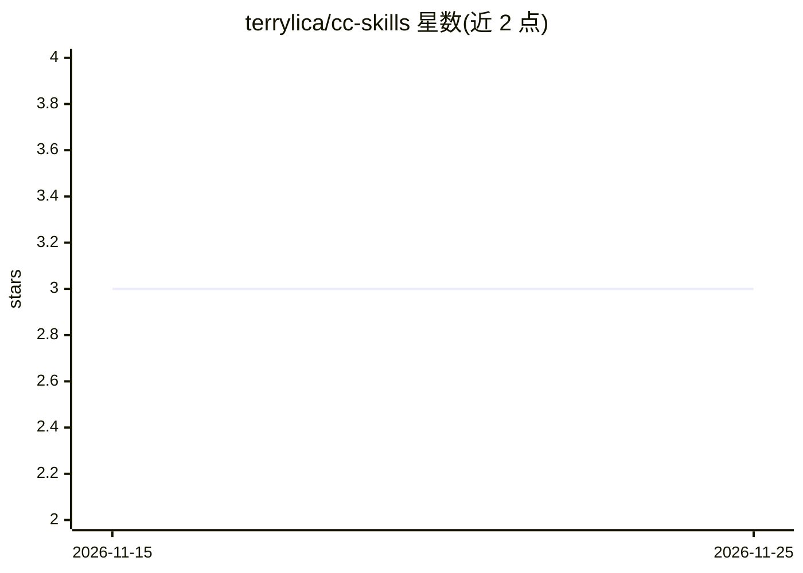

# terrylica/cc-skills

⭐ 3 · TypeScript · MIT · 推送 2026-11-23 · [GitHub](https://github.com/terrylica/cc-skills) · 个人维护

**为 Claude Code 用户提供插件/技能市场，覆盖开发与 DevOps 工作流**

面向 Claude Code 的插件市场仓库，以 marketplace.json 为唯一事实源收录 30+ 插件，类别覆盖开发流程（ADR 驱动的 itp 工作流、插件开发）、DevOps 自动化（ClickHouse、MLflow、Cloudflare Workers）、文档工具、质量检查、交易研究等。通过 claude plugin 命令添加市场并安装插件，插件自带 hooks 由 Claude Code 自行加载；另含 Windows 安装故障排查与本地目录市场的备选安装路径。

## 筛选速览

| 维度 | 判定 | 备注 |
|---|---|---|
| AI 角色 | `ai-ecosystem` | LLM/agent 周边工具 |
| 许可风险 | `permissive` | MIT |
| 部署形态 | `library` | 以包/库形式分发 |
| 模型依赖 | — | README 未给出锁定关系 |
| 硬件要求 | — | 无带数字的原话,不猜 |
| 安装摩擦 | `low` | 无编译、无系统依赖或容器化 |
| 成熟度 | — | 结构信号不足 |

## 能力要点

- 收录 30+ 插件，由 marketplace.json 生成目录并提供校验脚本
- 通过 claude plugin marketplace add / plugin install 命令安装
- 插件 hooks 由 Claude Code 自动加载，无需写入用户 settings.json
- 覆盖 ADR 开发工作流、DevOps 自动化、文档与质量工具等类别

## 适用场景

- 为 Claude Code 扩展开发与 DevOps 自动化插件
- 用 itp 工作流插件执行 ADR 驱动的四阶段开发
- 管理 ClickHouse、MLflow 等 DevOps 工具的自动化操作

## 场景标签

`提示工程` `编码 Agent` `工作流自动化` · 领域:Agent 开发

## 证据(README 行号)

> L3: Claude Code Skills Marketplace: Meta-skills, foundational tools and workflow hooks for Claude Code.
> L74: claude plugin marketplace add terrylica/cc-skills
> L92: claude plugin install itp@cc-skills

## 星数曲线

2026-11-15 3 → 2026-11-25 3（+0）

---
*卡片 v1 · prompt 1.4 · 生成 2026-11-21 · 置信度 mid · 依据 README sha `071952f8d531` · [字段定义](../../DATASET.md)*
