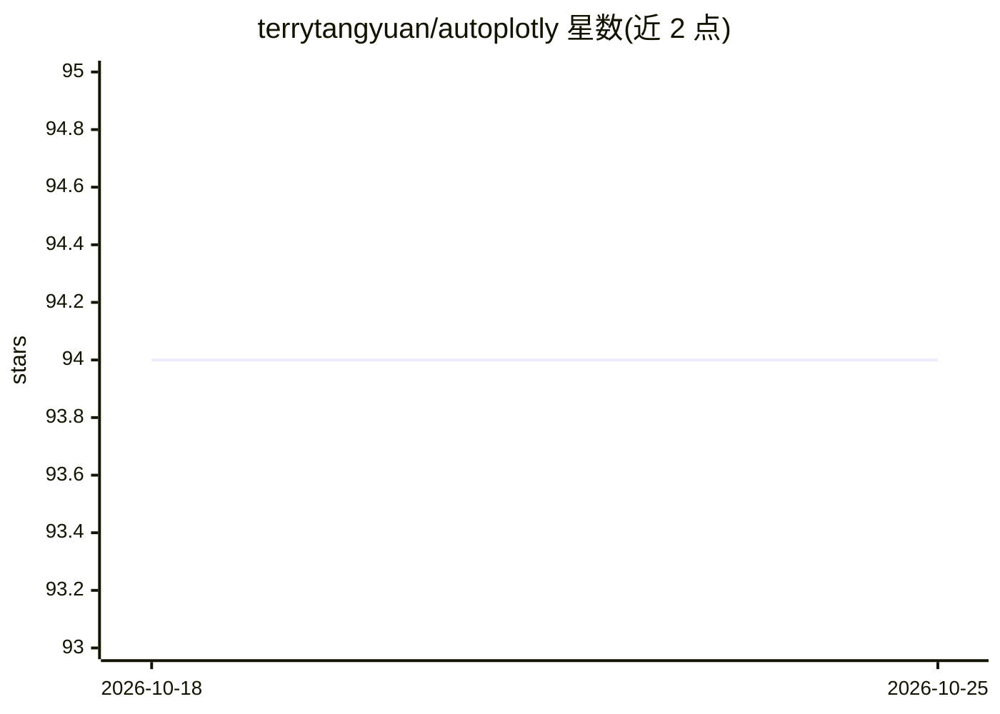

# terrytangyuan/autoplotly

⭐ 94 · R · 推送 2026-08-23 · [GitHub](https://github.com/terrytangyuan/autoplotly) · 个人维护

**R 包：将统计结果自动生成为 plotly.js 交互式可视化**

基于 ggfortify、ggplot2 与 plotly.js 的 R 包，对主成分分析、聚类等流行统计结果自动生成交互式可视化，无需手动编写绘图代码。生成的图形可继续用 ggplot2 语法叠加扩展并保持交互性。提供 CRAN 安装与 GitHub 开发版安装两种途径，附 JOSS 论文引用格式，并说明与 ggplot2 3.x/4.0 在不同 R 版本下的组合兼容方式。面向使用 R 做统计分析与可视化的用户。

## 筛选速览

| 维度 | 判定 | 备注 |
|---|---|---|
| AI 角色 | `ai-enhanced` | 去掉 AI 部分产品仍成立 |
| 许可风险 | `none` | — |
| 部署形态 | `None` |  |
| 模型依赖 | — | README 未给出锁定关系 |
| 硬件要求 | — | 无带数字的原话,不猜 |
| 安装摩擦 | `low` | 无编译、无系统依赖或容器化 |
| 成熟度 | — | 结构信号不足 |

## 能力要点

- 借助 ggfortify 自动为多种统计结果生成交互式图形
- 输出可用 ggplot2 语法继续扩展且保持交互
- 提供 CRAN 与 GitHub 两种安装方式
- 给出 ggplot2 4.0 及 R 版本组合的兼容说明

## 适用场景

- 对 prcomp、聚类等统计结果快速生成交互式图表
- 在已有 R 统计分析流程中嵌入自动可视化
- 用 ggplot2 语法定制自动生成的交互图形

## 场景标签

 · 领域:数据可视化/统计

## 证据(README 行号)

> L9: This R package provides functionalities to automatically generate interactive visualizations for many
> L10: popular statistical results supported by ggfortify
> L11: package with plotly.js and ggplot2 style.

## 星数曲线

2026-10-18 94 → 2026-10-25 94（+0）

---
*卡片 v1 · prompt 1.4 · 生成 2026-10-23 · 置信度 high · 依据 README sha `220dccd1149d` · [字段定义](../../DATASET.md)*
