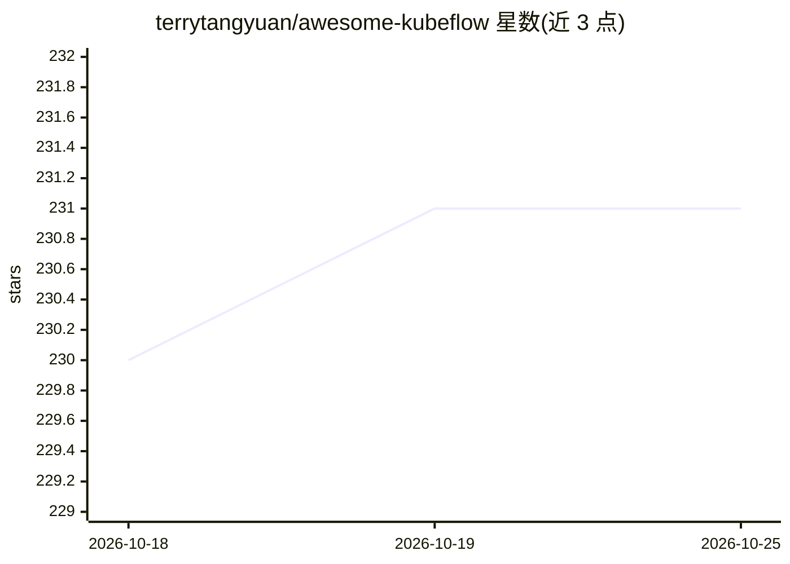

# terrytangyuan/awesome-kubeflow

⭐ 231 · Apache-2.0 · 推送 2026-09-18 · [GitHub](https://github.com/terrytangyuan/awesome-kubeflow) · [官网](https://terrytangyuan.github.io/awesome-kubeflow/) · 个人维护

**Kubeflow 相关项目与资源策展清单：面向 ML/MLOps 从业者**

围绕 CNCF 项目 Kubeflow 的策展资源清单：收录 Kubeflow 主仓库、Katib（AutoML）、Pipelines、Training Operator、Arena CLI 等核心组件，以及 Argo Workflows、KServe、MLRun、Seldon、ZenML 等集成生态项目；另按书籍、博客文章、视频（Kubeflow Summit 与社区会议录像）分类整理学习材料。内容覆盖 K8s 上 ML 工作流部署、分布式训练、超参调优与模型服务。清单本身为 Markdown 条目，无需安装运行。

## 筛选速览

| 维度 | 判定 | 备注 |
|---|---|---|
| AI 角色 | `ai-knowledge` | 知识聚合/清单类 |
| 许可风险 | `permissive` | Apache-2.0 |
| 部署形态 | `None` |  |
| 模型依赖 | — | README 未给出锁定关系 |
| 硬件要求 | — | 无带数字的原话,不猜 |
| 安装摩擦 | `low` | 无编译、无系统依赖或容器化 |
| 成熟度 | — | 结构信号不足 |

## 能力要点

- 收录 Kubeflow 核心组件与十余个集成开源项目
- 分类整理 5 本 Kubeflow/MLOps 相关书籍
- 聚合博客文章与 Kubeflow Summit 各年度视频播放列表

## 适用场景

- 查找 Kubeflow 生态组件与集成工具
- 寻找 Kubeflow 与云原生 ML 的学习书籍和视频
- 了解 Kubeflow 社区动态与会议资源

## 场景标签

`精选清单` · 领域:学习与行业

## 证据(README 行号)

> L14: A curated list of awesome projects and resources related to Kubeflow, a Cloud Native Computing Foundation (CNCF) in
> L24: ## Ecosystem Projects

## 星数曲线

2026-10-18 230 → 2026-10-25 231（+1）

---
*卡片 v1 · prompt 1.4 · 生成 2026-10-22 · 置信度 high · 依据 README sha `e21f6cabf1ea` · [字段定义](../../DATASET.md)*
