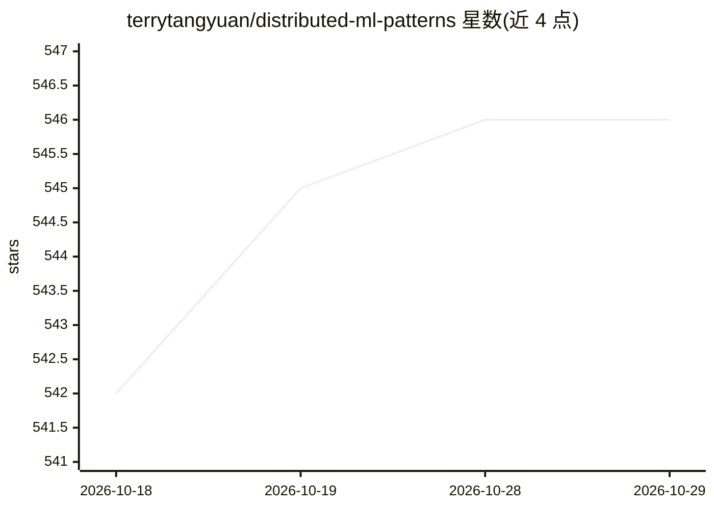

# terrytangyuan/distributed-ml-patterns

⭐ 546 · Python · Apache-2.0 · 推送 2026-01-06 · [GitHub](https://github.com/terrytangyuan/distributed-ml-patterns) · [官网](https://bit.ly/2RKv8Zo) · 个人维护 · 中文 README

**分布式机器学习模式：Manning 出版书籍的参考与代码仓库**

Yuan Tang 所著 Manning 出版书籍《Distributed Machine Learning Patterns》的配套仓库，包含书籍参考文献与代码。书籍内容覆盖构建可扩展机器学习系统的模式：数据摄取、分布式训练、模型服务、用 Kubernetes/TensorFlow/Kubeflow/Argo Workflows 自动化机器学习任务、模式间权衡与大规模工作负载管理。面向具备机器学习基础、了解 Bash/Python/Docker 的数据分析师、数据科学家与软件工程师，另有韩文与中文版由清华大学出版社出版。

## 筛选速览

| 维度 | 判定 | 备注 |
|---|---|---|
| AI 角色 | `ai-knowledge` | 知识聚合/清单类 |
| 许可风险 | `permissive` | Apache-2.0 |
| 部署形态 | `None` |  |
| 模型依赖 | — | README 未给出锁定关系 |
| 硬件要求 | — | 无带数字的原话,不猜 |
| 安装摩擦 | `low` | 无编译、无系统依赖或容器化 |
| 成熟度 | — | 结构信号不足 |

## 能力要点

- 覆盖数据摄取、分布式训练、模型服务等管道模式
- 以 Kubernetes、Kubeflow、Argo Workflows、TensorFlow 为技术栈
- 提供书籍配套参考与代码

## 适用场景

- 系统学习分布式机器学习系统的构建模式
- 将单机模型训练迁移到分布式集群的实践参考
- MLOps 工程任务的代码示例来源

## 场景标签

`MLOps` `教程课程` · 领域:学习与行业

## 证据(README 行号)

> L12: This repository contains references and code for the book *Distributed Machine Learning Patterns* from Manning Publ
> L20: * Apply patterns to build scalable and reliable machine learning systems.
> L22: * Automate machine learning tasks with Kubernetes, TensorFlow, Kubeflow, and Argo Workflows.

## 星数曲线

2026-10-18 542 → 2026-10-29 546（+4）

---
*卡片 v1 · prompt 1.4 · 生成 2026-10-21 · 置信度 high · 依据 README sha `a1c97276b1e9` · [字段定义](../../DATASET.md)*
