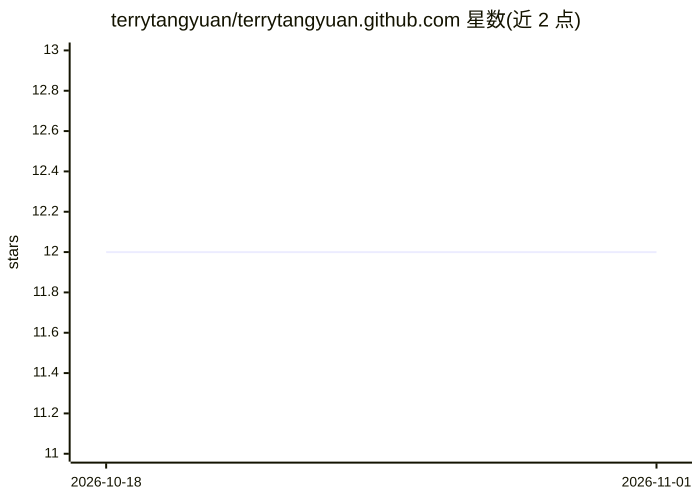

# terrytangyuan/terrytangyuan.github.com

⭐ 12 · HTML · Apache-2.0 · 推送 2026-10-31 · [GitHub](https://github.com/terrytangyuan/terrytangyuan.github.com) · [官网](http://terrytangyuan.github.io/) · 个人维护

**个人博客网站：Jekyll 构建的静态个人主页与博文站点**

Yuan Tang 的个人网站源码仓库，基于 Jekyll 4.3.4+ 的静态站点，通过 GitHub Actions 自动化构建并部署到 GitHub Pages。README 描述的是站点工程本身：npm scripts 构建流程（替代原 Grunt）、Sass 预处理、ESLint/Prettier 代码检查、HTML 校验与死链检测、响应式与 SEO 优化。博文存放于 _posts/ 目录，主页包含 about/cv/projects 页面。仓库主题标签涉及机器学习与云计算，属博主内容方向，README 未描述 AI 功能。

## 筛选速览

| 维度 | 判定 | 备注 |
|---|---|---|
| AI 角色 | `ai-knowledge` | 知识聚合/清单类 |
| 许可风险 | `permissive` | Apache-2.0 |
| 部署形态 | `None` |  |
| 模型依赖 | — | README 未给出锁定关系 |
| 硬件要求 | — | 无带数字的原话,不猜 |
| 安装摩擦 | `low` | 无编译、无系统依赖或容器化 |
| 成熟度 | — | 结构信号不足 |

## 能力要点

- Jekyll 4.3.4+ 静态站点生成，GitHub Actions 自动部署到 GitHub Pages
- npm scripts 构建、Sass 预处理、ESLint/Prettier 检查
- HTML 校验、死链检测与 CV 链接检查脚本
- 博文按 YYYY-MM-DD-title.markdown 命名约定存放于 _posts/

## 适用场景

- 托管个人博客与简历/项目展示页面
- 以 GitHub Pages 自动化部署个人静态站点

## 场景标签

 · 领域:个人网站/静态站点

## 证据(README 行号)

> L1: # Yuan Tang's Personal Website
> L3: A modern Jekyll-based personal website with secure dependencies and automated deployment.

## 星数曲线

2026-10-18 12 → 2026-11-01 12（+0）

---
*卡片 v1 · prompt 1.4 · 生成 2026-10-31 · 置信度 low · 依据 README sha `a7e05588b17c` · [字段定义](../../DATASET.md)*
