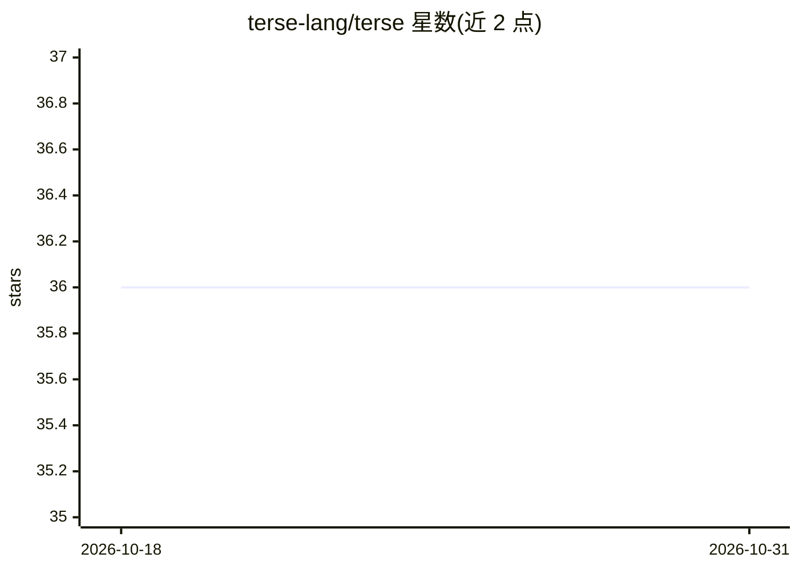

# terse-lang/terse

⭐ 36 · Python · Apache-2.0 · 推送 2026-07-24 · [GitHub](https://github.com/terse-lang/terse) · 组织维护

**面向人类与 AI agent 的层级状态语言及配套工具链**

定义一种基于文件、层级化的状态格式 `.terse`，用容器标记与裸名对象行表达状态，配套 `?` 只读查询与声明式变更语法（放置/重命名/合并/移动等指令）。仓库含规范、零运行时依赖的 Python 实现（解析器、CLI）、暴露状态存储的 MCP 服务器（terse_command/terse_info 两工具）、Claude Code/OpenClaw/Grok/Hermes 集成，以及 agent 记忆与个人知识库应用。状态为 pre-release，1.0 前 API 与规范可能变动。

## 筛选速览

| 维度 | 判定 | 备注 |
|---|---|---|
| AI 角色 | `ai-ecosystem` | LLM/agent 周边工具 |
| 许可风险 | `permissive` | Apache-2.0 |
| 部署形态 | `None` |  |
| 模型依赖 | — | README 未给出锁定关系 |
| 硬件要求 | — | 无带数字的原话,不猜 |
| 安装摩擦 | `low` | 无编译、无系统依赖或容器化 |
| 成熟度 | `idea` | |

## 能力要点

- 声明式变更语法：未提及内容保持不变
- 零运行时依赖的 Python 实现，含 validate/parse/fmt/query/apply CLI
- MCP 服务器暴露 TERSE 状态存储为两个工具
- terse-memory 提供 agent 持久记忆与存储内策略协议

## 适用场景

- 为 MCP host（Claude Code/OpenClaw/Grok/Hermes）提供可查询的状态存储
- 为 agent 构建跨会话持久记忆
- 维护单操作者+agent 的个人知识库（terse-brain）

## 场景标签

`Agent 记忆` `知识库管理` · 领域:Agent 开发

## 证据(README 行号)

> L84: |`terse-mcp/`|MCP server exposing a TERSE state store as two tools — `terse_command` (one call, two channels: `decl
> L87: |`apps/terse-memory/`|Durable agent memory on TERSE — the `memory` namespace, `init`/`wire`/`setup`/`doctor`, and a
> L5: TERSE is an AI-first, human-readable state format with a matching query/command syntax, designed to be:

## 星数曲线

2026-10-18 36 → 2026-10-31 36（+0）

---
*卡片 v1 · prompt 1.4 · 生成 2026-10-25 · 置信度 high · 依据 README sha `2f3ba71e0754` · [字段定义](../../DATASET.md)*
