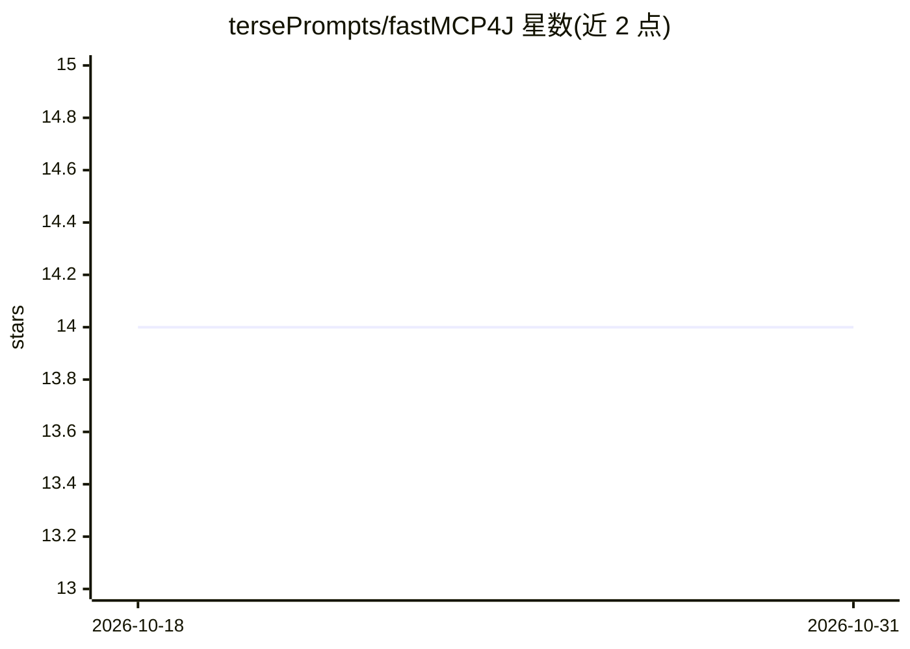

# tersePrompts/fastMCP4J

⭐ 14 · Java · MIT · 推送 2026-09-07 · [GitHub](https://github.com/tersePrompts/fastMCP4J) · [官网](https://central.sonatype.com/artifact/io.github.terseprompts/fastmcp-java) · 个人维护

**Java 17+ 注解驱动的 MCP 服务器 SDK，内置沙箱 bash 终端**

面向 Java 开发者的 Model Context Protocol（spec 2.0.1）SDK：一个注解把类变成 MCP 服务器，暴露 tools/resources/prompts；内置 memory、todo、planner、文件读写等工具集，并经 @McpBash 提供基于 bashkit4j 的内存内 bash 沙箱（原生重实现 160+ 命令、虚拟文件系统、默认断网，主机不可达）。支持 stdio/SSE/streamable 三种传输、前后置 hook 与 OpenTelemetry。12 个依赖，冷启动 <500ms，需 Java 17+；当前为 v0.5.0-beta，沙箱模式需可选 bashkit4j 依赖。

## 筛选速览

| 维度 | 判定 | 备注 |
|---|---|---|
| AI 角色 | `ai-ecosystem` | LLM/agent 周边工具 |
| 许可风险 | `permissive` | MIT |
| 部署形态 | `None` |  |
| 模型依赖 | — | README 未给出锁定关系 |
| 硬件要求 | — | 无带数字的原话,不猜 |
| 安装摩擦 | `medium` | 含编译或系统依赖之一 |
| 成熟度 | `idea` | |

## 能力要点

- 注解驱动：@McpServer/@McpTool 等注解声明式生成 MCP 服务器
- bashkit4j 内存内 bash 沙箱：不 spawn 真实 bash、默认断网、挂载需显式授权
- 内置 @McpMemory/@McpTodo/@McpPlanner/@McpFileRead/@McpFileWrite 工具集
- 支持 stdio/SSE/streamable 传输与 OpenTelemetry 遥测

## 适用场景

- 把 Java 服务以注解方式暴露为 Claude、Cursor 等 MCP 客户端的工具
- 给 AI agent 提供受控沙箱终端执行多步命令工作流
- 在 Spring/DI 既有代码库上无侵入接入 MCP

## 场景标签

 · 领域:MCP/Agent 工具开发

## 证据(README 行号)

> L19: FastMCP4J is an annotation-driven SDK for the
> L22: AI agent a real terminal — **a bash sandbox where the host is unreachable by
> L289: - **AI/LLM engineers** — expose Java services to Claude, Cursor, or any MCP

## 星数曲线

2026-10-18 14 → 2026-10-31 14（+0）

---
*卡片 v1 · prompt 1.4 · 生成 2026-10-31 · 置信度 high · 依据 README sha `fdb442674f8b` · [字段定义](../../DATASET.md)*
