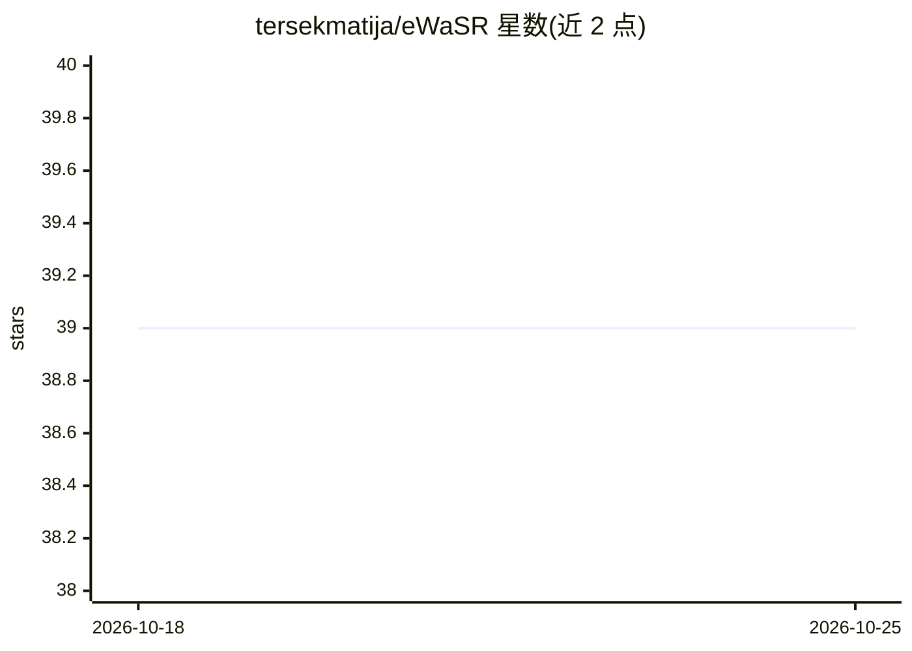

# tersekmatija/eWaSR

⭐ 39 · Python · Apache-2.0 · 推送 2026-10-08 · [GitHub](https://github.com/tersekmatija/eWaSR) · 组织维护

**面向嵌入式计算的海上障碍物检测网络 PyTorch 实现**

eWaSR 的官方 PyTorch 实现：WaSR 的嵌入式计算变体，基于轻量 transformer 设计，用于无人水面艇（USV）的海面障碍物检测与语义分割。仓库提供 MaSTr1325 数据集上的预训练权重（ResNet-18 骨干，可选 IMU 输入）、训练脚本、推理脚本，并可导出 ONNX 与兼容 OAK-D 设备的 blob。训练依赖 PyTorch Lightning，日志经 TensorBoard 查看，代码与权重以 Apache-2.0 发布。

## 筛选速览

| 维度 | 判定 | 备注 |
|---|---|---|
| AI 角色 | `ai-native` | 本体是模型或模型工具 |
| 许可风险 | `permissive` | Apache-2.0 |
| 部署形态 | `library` | 以包/库形式分发 |
| 模型依赖 | — | README 未给出锁定关系 |
| 硬件要求 | `cpu-ok` | |
| 安装摩擦 | `low` | 无编译、无系统依赖或容器化 |
| 成熟度 | — | 结构信号不足 |

## 能力要点

- WaSR 嵌入式变体，推理时间相比 WaSR 降低 10 倍以上
- 提供 MaSTr1325 预训练权重（含 IMU 启用版本）
- 可导出 ONNX 及 OAK-D 兼容 blob
- 支持训练 WaSR 官方架构与 DeepLab 等多种骨干

## 适用场景

- 无人水面艇的实时海上障碍物检测
- 在 OAK-D 等嵌入式设备上部署分割模型
- 在 MaSTr1325 数据集上复现或训练检测模型

## 场景标签

 · 领域:机器人视觉/海事感知

## 证据(README 行号)

> L9: The official PyTorch implementation of the **e**mbedded-compute **WaSR (eWaSR)** network [1]. Repository contains sc
> L40: You can export the pre-trained model to ONNX and blob compatible with OAK-D device.

## 星数曲线

2026-10-18 39 → 2026-10-25 39（+0）

---
*卡片 v1 · prompt 1.4 · 生成 2026-10-25 · 置信度 mid · 依据 README sha `1472469abda0` · [字段定义](../../DATASET.md)*
