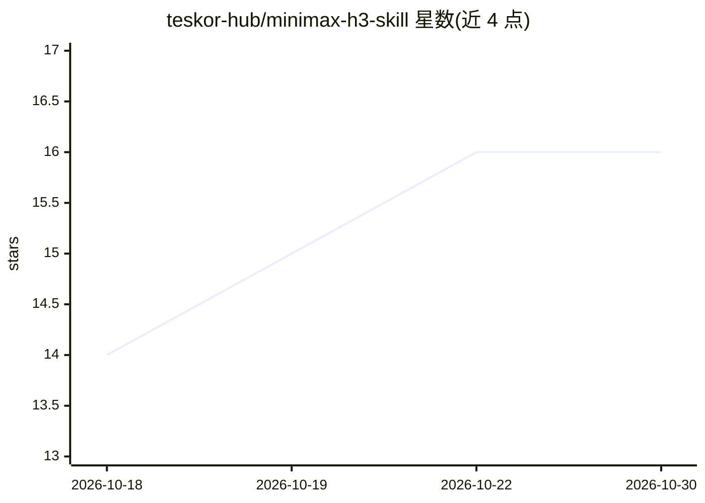

# teskor-hub/minimax-h3-skill

⭐ 16 · Python · MIT · 推送 2026-09-19 · [GitHub](https://github.com/teskor-hub/minimax-h3-skill) · 个人维护

**面向 Claude Code 的 MiniMax H3 视频生成提示词技能与工作流模板**

为开源全模态视频模型 MiniMax H3 编写的提示词知识包：以 Claude Code skill（SKILL.md + references/）形式安装，内容覆盖官方 T2VA/I2VA/FL2VA/Ref2VA 六段式提示结构、镜头词汇、两个 66GB checkpoint 的区别、ComfyUI 量化与 VRAM 选型、症状→修复排错表，以及 Reel Maker 两种可直接导入 ComfyUI 的工作流 JSON（源视频重构与纯照片模式）。另提供可粘贴到任意聊天模型的 portable-prompt 与整段短视频流水线提示。模型权重与个人照片素材不随包分发，纯照片工作流图本地检查过但未做 GPU 渲染验证。

## 筛选速览

| 维度 | 判定 | 备注 |
|---|---|---|
| AI 角色 | `ai-knowledge` | 知识聚合/清单类 |
| 许可风险 | `permissive` | MIT |
| 部署形态 | `None` |  |
| 模型依赖 | — | README 未给出锁定关系 |
| 硬件要求 | — | 无带数字的原话,不猜 |
| 安装摩擦 | `low` | 无编译、无系统依赖或容器化 |
| 成熟度 | — | 结构信号不足 |

## 能力要点

- SKILL.md + 7 个 references 覆盖提示格式、模板、ComfyUI 选型与排错
- Ref + ControlNet / Ref Only 两种模式的 ComfyUI 工作流 JSON 模板与 configure_workflow.py 打包脚本
- portable-prompt.md 可粘贴到任意聊天模型，无需 Claude Code 或安装
- 按用户实际 VRAM 推荐 checkpoint 而非通用表格

## 适用场景

- 让 Claude Code 按 MiniMax 官方结构写 H3 视频提示词
- 用照片或源视频重建短视频/reel 时选择正确工作流
- 在 ChatGPT 等普通聊天中粘贴同一套提示框架使用

## 场景标签

`提示工程` `视频生成` · 领域:Agent 开发

## 证据(README 行号)

> L1: # MiniMax H3 — Claude Code Skill
> L45: A Claude Code skill for **MiniMax H3**, the open-weight omni-modal video model that generates video *and* native st
> L81: **`portable-prompt.md` is not a skill — it is a prompt.** A single self-contained instruction you paste into an ord

## 星数曲线

2026-10-18 14 → 2026-10-30 16（+2）

---
*卡片 v1 · prompt 1.4 · 生成 2026-10-30 · 置信度 high · 依据 README sha `52b129f46597` · [字段定义](../../DATASET.md)*
