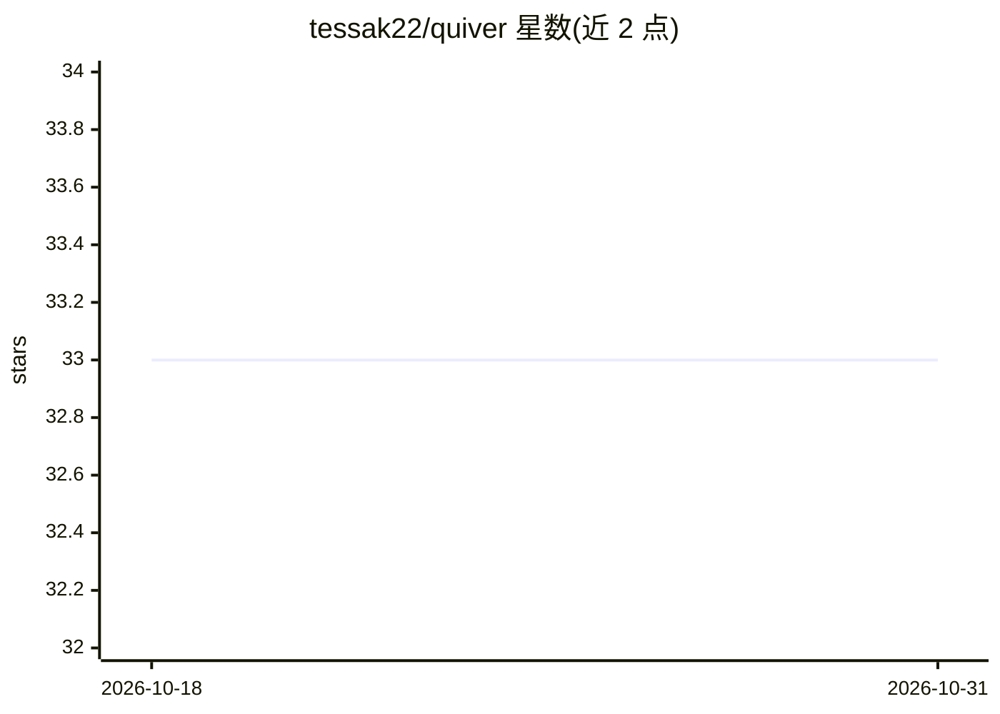

# tessak22/quiver

⭐ 33 · TypeScript · MIT · 推送 2026-09-29 · [GitHub](https://github.com/tessak22/quiver) · [官网](https://quivergtm.dev) · 个人维护

**面向开发者工具团队的 Agent 营销系统：带上下文版本化记录**

开源、自托管的 agentic 开发者营销系统，服务做开发者工具的技术创始人与团队。它把产品上下文（定位/ICP/信息）、客户研究、战役、内容与成果关联为带版本的记录体系，提供 Strategy/Create/Feedback/Analyze/Optimize 五种 AI 会话模式，并暴露 MCP stdio 与 HTTP 端点供外部 agent 访问同一批记录。自托管需自行运营 Vercel 应用、Supabase（Postgres+Auth）与 Anthropic API key；另有 hosted Quiver 托管版，功能与本仓库独立。它不替代发布渠道、CRM 或分析工具。

## 筛选速览

| 维度 | 判定 | 备注 |
|---|---|---|
| AI 角色 | `ai-native` | 本体是模型或模型工具 |
| 许可风险 | `permissive` | MIT |
| 部署形态 | `library` | 以包/库形式分发 |
| 模型依赖 | locked-api |  |
| 硬件要求 | — | 无带数字的原话,不猜 |
| 安装摩擦 | `low` | 无编译、无系统依赖或容器化 |
| 成熟度 | — | 结构信号不足 |

## 能力要点

- 版本化产品上下文与提案式更新审查机制
- Strategy/Create/Feedback/Analyze/Optimize 五种 AI 会话模式
- 本地 stdio 与远程 HTTP 的 MCP 服务器，向外部 agent 暴露 8 类记录工具
- 公开 Content API 以 JSON 返回已发布内容（60 请求/分钟限速）

## 适用场景

- 团队把定位、客户研究与战役成果沉淀为可追溯的营销记录
- 通过 MCP 客户端在外部 agent 中读写 Quiver 的上下文与成果
- 自有站点通过 Content API 拉取并渲染已发布内容

## 场景标签

`AI 写作` `知识库管理` · 领域:内容生成

## 证据(README 行号)

> L27: The web UI runs Quiver's five AI session modes. MCP clients can work with the same context, campaigns, artifacts, r
> L34: |Sessions & skills|Use Strategy, Create, Feedback, Analyze, or Optimize modes with skills loaded for the task and p

## 星数曲线

2026-10-18 33 → 2026-10-31 33（+0）

---
*卡片 v1 · prompt 1.4 · 生成 2026-10-26 · 置信度 high · 依据 README sha `4a9672b491e7` · [字段定义](../../DATASET.md)*
