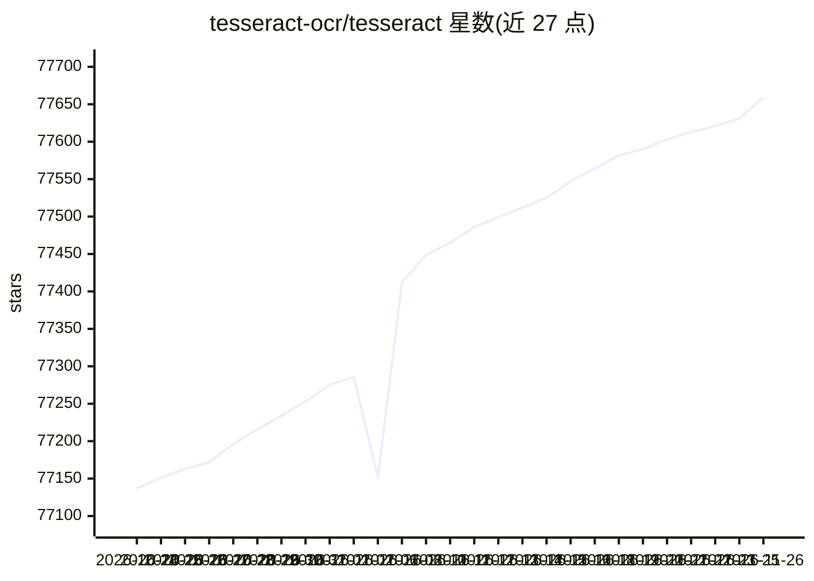

# tesseract-ocr/tesseract

⭐ 77,659 · C++ · Apache-2.0 · 推送 2026-11-25 · [GitHub](https://github.com/tesseract-ocr/tesseract) · [官网](https://tesseract-ocr.github.io/) · 组织维护

**OCR 引擎库与命令行工具：识别 100+ 种语言文字**

包含 OCR 引擎 libtesseract 和命令行程序 tesseract。第 4 版引入基于 LSTM 神经网络的行识别引擎，同时通过 --oem 0 兼容第 3 版的字符模式识别旧引擎。支持 Unicode（UTF-8），开箱即支持 100 多种语言，可训练识别其他语言。输入支持 PNG、JPEG、TIFF 等图像格式，输出纯文本、hOCR、PDF、TSV、ALTO、PAGE 等格式。依赖 Leptonica 库读写图像，不包含 GUI 应用，需配合 traineddata 训练数据文件使用。

## 筛选速览

| 维度 | 判定 | 备注 |
|---|---|---|
| AI 角色 | `ai-native` | 本体是模型或模型工具 |
| 许可风险 | `permissive` | Apache-2.0 |
| 部署形态 | `None` |  |
| 模型依赖 | — | README 未给出锁定关系 |
| 硬件要求 | — | 无带数字的原话,不猜 |
| 安装摩擦 | `low` | 无编译、无系统依赖或容器化 |
| 成熟度 | — | 结构信号不足 |

## 动量与使用信号

- 维护:`active` — 距上次 push 8.1 天,年发版 2,205 位贡献者
- 涨星:近 1 天 **+18**(自 20261016 起算)
- 平台:WINDOWS · 协议:—

## 能力要点

- LSTM 神经网络引擎与 legacy 引擎（--oem 0）两种 OCR 模式
- 开箱支持 100+ 种语言，可自行训练新语言
- 多种输出格式：纯文本/hOCR/PDF/TSV/ALTO/PAGE
- 提供 C/C++ API 及多语言 wrapper

## 适用场景

- 从扫描文档图片提取可搜索的 PDF 或文本
- 批量识别截图、票据图像中的文字并导出 TSV
- 在应用中通过 libtesseract C/C++ API 集成 OCR 功能

## 场景标签

`OCR` · 领域:感知与多模态

## 证据(README 行号)

> L14: This package contains an **OCR engine** - `libtesseract` and a **command line program** - `tesseract`.
> L16: Tesseract 4 adds a new neural net (LSTM) based OCR engine which is focused on line recognition, but also still supp
> L22: Tesseract has **unicode (UTF-8) support**, and can **recognize more than 100 languages** "out of the box".

## 星数曲线

2026-10-24 77,137 → 2026-11-26 77,659（+522）

---
*卡片 v1 · prompt 1.4 · 生成 2026-11-24 · 置信度 high · 依据 README sha `0e25806ebb2b` · [字段定义](../../DATASET.md)*
