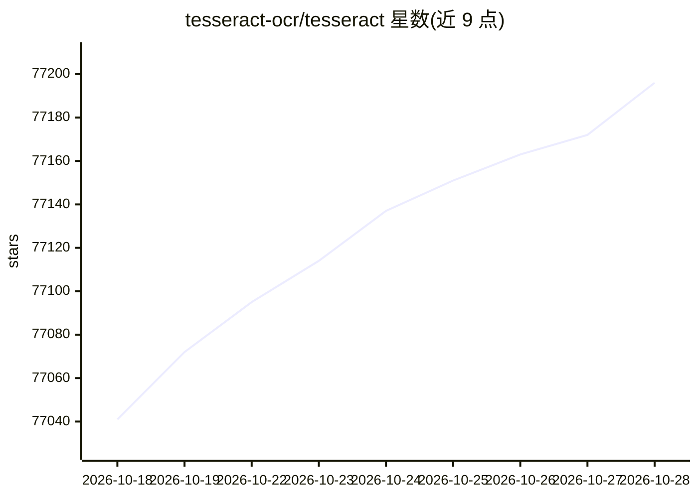

# tesseract-ocr/tesseract

⭐ 77,196 · C++ · Apache-2.0 · 推送 2026-10-27 · [GitHub](https://github.com/tesseract-ocr/tesseract) · [官网](https://tesseract-ocr.github.io/) · 组织维护

**OCR 引擎：为开发者提供图片文字识别库与命令行工具**

包含 OCR 引擎 libtesseract 与命令行程序 tesseract 两个部分。第 4 版引入基于 LSTM 神经网络的行识别引擎，同时通过 --oem 0 兼容第 3 版的字符模式识别引擎。支持 Unicode/UTF-8，开箱可识别 100 多种语言，支持 PNG、JPEG、TIFF 等图像输入，输出纯文本、hOCR、PDF、TSV、ALTO、PAGE 等格式。不含 GUI，可通过 tessdata 训练数据支持更多语言，开发者可经 C/C++ API 或多语言 wrapper 集成。依赖 Leptonica 库读取图像。

## 筛选速览

| 维度 | 判定 | 备注 |
|---|---|---|
| AI 角色 | `ai-enhanced` | 去掉 AI 部分产品仍成立 |
| 许可风险 | `permissive` | Apache-2.0 |
| 部署形态 | `None` |  |
| 模型依赖 | — | README 未给出锁定关系 |
| 硬件要求 | — | 无带数字的原话,不猜 |
| 安装摩擦 | `low` | 无编译、无系统依赖或容器化 |
| 成熟度 | — | 结构信号不足 |

## 动量与使用信号

- 维护:`active` — 距上次 push 8.1 天,年发版 2,205 位贡献者
- 涨星:近 1 天 **+18**(自 20261016 起算)
- 平台:WINDOWS · 协议:—

## 能力要点

- 提供 libtesseract 库与 tesseract 命令行程序两种使用方式
- 支持 LSTM 引擎与 Legacy 引擎两种 OCR 模式（--oem 切换）
- 开箱支持 100 多种语言，输出文本/hOCR/PDF/TSV/ALTO/PAGE 等格式
- 提供 C/C++ API 与其他语言的 wrapper 绑定

## 适用场景

- 从 PNG/JPEG/TIFF 图片中批量提取文字
- 生成带文本层的可搜索 PDF 或 hOCR 结构化输出
- 通过 C/C++ API 在自有应用中嵌入 OCR 能力
- 训练引擎识别新的语言或字符集

## 场景标签

`OCR` · 领域:感知与多模态

## 证据(README 行号)

> L14: This package contains an **OCR engine** - `libtesseract` and a **command line program** - `tesseract`.
> L16: Tesseract 4 adds a new neural net (LSTM) based OCR engine which is focused on line recognition, but also still supp
> L22: Tesseract has **unicode (UTF-8) support**, and can **recognize more than 100 languages** "out of the box".

## 星数曲线

2026-10-18 77,041 → 2026-10-28 77,196（+155）

---
*卡片 v1 · prompt 1.4 · 生成 2026-10-18 · 置信度 high · 依据 README sha `2af580546cbe` · [字段定义](../../DATASET.md)*
