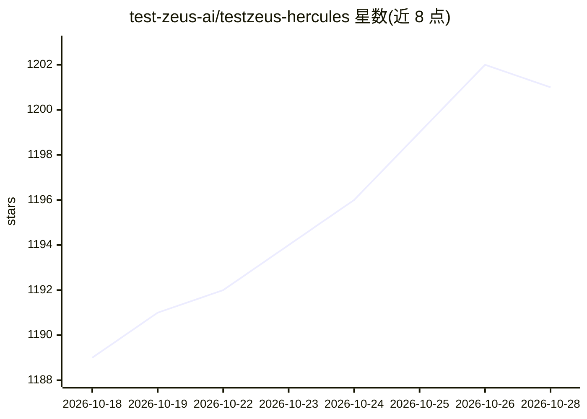

# test-zeus-ai/testzeus-hercules

⭐ 1,201 · Python · AGPL-3.0 · 推送 2026-10-24 · [GitHub](https://github.com/test-zeus-ai/testzeus-hercules) · [官网](https://testzeus.com/hercules) · 组织维护

**无代码端到端测试 Agent：Gherkin 步骤自动转为 UI/API 测试**

TestZeus 开发的开源测试 Agent：输入 Gherkin 特性文件，由 planner 模型生成严格 JSON 计划并路由到浏览器导航、API、安全、SQL、MCP 等执行 helper（基于 LangGraph 状态图与 LangChain StructuredTool），自动执行端到端测试并输出 JUnit XML、HTML 报告、视频、截图与网络日志。支持多 LLM 提供商（OpenAI、Anthropic、Ollama 等），支持 Python 沙箱执行自定义脚本。以 pip 包分发，Windows 提供辅助安装脚本，依赖 Playwright 与 FFmpeg。

## 筛选速览

| 维度 | 判定 | 备注 |
|---|---|---|
| AI 角色 | `ai-native` | 本体是模型或模型工具 |
| 许可风险 | `viral` | AGPL-3.0 |
| 部署形态 | `self-host` | docker 或自建部署 |
| 模型依赖 | local-ok | 支持本地模型 |
| 硬件要求 | — | 无带数字的原话,不猜 |
| 安装摩擦 | `low` | 无编译、无系统依赖或容器化 |
| 成熟度 | — | 结构信号不足 |

## 能力要点

- Gherkin 特性文件自动转为端到端测试，无需写代码
- LangGraph 状态图 + planner/helper 多 agent 执行流程，含 browser/api/sec/sql/mcp 等导航 helper
- 支持 OpenAI、Anthropic、Gemini（经 LiteLLM）、Ollama 等多种 LLM 提供商与按 agent 分模型路由
- 输出 JUnit XML、HTML 报告、视频、截图、网络日志等执行证明

## 适用场景

- 用自然语言/BDD 步骤编写 Web 端到端测试并接入 CI/CD
- 对多语言网页内容做自动化验证
- 在 Gherkin 测试中调用自定义 Python 脚本处理复杂逻辑
- 执行 UI、API、安全、可访问性与视觉校验等测试

## 场景标签

`浏览器自动化` · 领域:效率与自动化

## 证据(README 行号)

> L10: Testing modern web applications can be difficult, with frequent changes and complex features making it hard to keep
> L237: - `SimpleHercules` creates a LangGraph state graph for the run.
> L238: - The planner node turns the feature file into strict JSON containing the

## 星数曲线

2026-10-18 1,189 → 2026-10-28 1,201（+12）

---
*卡片 v1 · prompt 1.4 · 生成 2026-10-21 · 置信度 high · 依据 README sha `6624dff6775d` · [字段定义](../../DATASET.md)*
