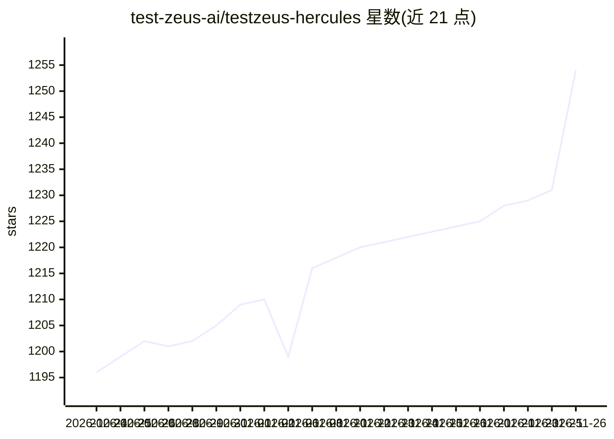

# test-zeus-ai/testzeus-hercules

⭐ 1,254 · Python · AGPL-3.0 · 推送 2026-11-23 · [GitHub](https://github.com/test-zeus-ai/testzeus-hercules) · [官网](https://testzeus.com/hercules) · 组织维护

**开源 QA 测试 agent：自然语言驱动的端到端测试**

TestZeus 的开源 QA 引擎：用户以自然语言写测试步骤，由语言模型读取步骤并决定点击，代码在本地真实 Chromium 浏览器中执行动作并核对结果，每步给出截图与证据。提供 CLI（run.json/junit.xml）、本地 Tester Web UI 与通过 MCP 接入编码代理三种方式；测试范围覆盖 Web UI、API、数据库、移动端、可访问性/视觉检查与探索性测试。要求 macOS/Linux、Python 3.13+ 与一个模型端点；支持 Docker 运行，测试用例为 JSON 或 Gherkin 文件。

## 筛选速览

| 维度 | 判定 | 备注 |
|---|---|---|
| AI 角色 | `ai-native` | 本体是模型或模型工具 |
| 许可风险 | `viral` | AGPL-3.0 |
| 部署形态 | `self-host` | docker 或自建部署 |
| 模型依赖 | local-ok | 支持本地模型 |
| 硬件要求 | — | 无带数字的原话,不猜 |
| 安装摩擦 | `low` | 无编译、无系统依赖或容器化 |
| 成熟度 | — | 结构信号不足 |

## 能力要点

- 自然语言测试步骤，模型决策点击、代码执行并核对结果
- CLI/Tester UI/编码代理（MCP）三种使用方式
- 通过 OpenAI 兼容接口接入本地或托管模型端点
- 覆盖 Web、API、数据库、移动端、可访问性与探索性测试

## 适用场景

- 不写选择器即可为 Web 应用做端到端测试
- 让编码代理写用例、跑测试并修复失败步骤
- 用 OpenAPI 文档批量生成 API 测试用例
- 以退出码与 junit.xml 接入 CI 流程

## 场景标签

`浏览器自动化` · 领域:效率与自动化

## 证据(README 行号)

> L10: Hercules is an open-source QA engine by TestZeus. You write test steps in plain
> L12: whether each step passed, with screenshots and evidence for every step. Language models
> L58: - **Coding agents**: Claude Code, Codex, Cursor, GitHub Copilot and Gemini CLI call Hercules over MCP. The agent

## 星数曲线

2026-10-24 1,196 → 2026-11-26 1,254（+58）

---
*卡片 v1 · prompt 1.4 · 生成 2026-11-25 · 置信度 mid · 依据 README sha `ddb2951b136b` · [字段定义](../../DATASET.md)*
