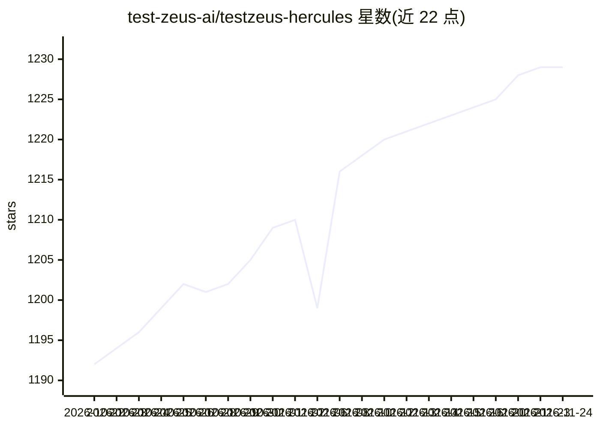

# test-zeus-ai/testzeus-hercules

⭐ 1,231 · Python · AGPL-3.0 · 推送 2026-11-23 · [GitHub](https://github.com/test-zeus-ai/testzeus-hercules) · [官网](https://testzeus.com/hercules) · 组织维护

**开源测试 agent：从 Gherkin 步骤自动生成端到端测试**

TestZeus 开源的自动化测试 agent，读取 Gherkin feature 文件后驱动浏览器执行 UI、API、安全、无障碍与视觉校验，无需编写测试代码。内部以 LangGraph 状态图组织 planner/executor 循环，导航助手绑定 LangChain StructuredTool 执行浏览器与 API 操作；需要外部 LLM（经 OpenAI 兼容接口或 agents_llm_config.json 按角色路由模型）。输出 JUnit XML、HTML 报告及视频、截图、网络日志等执行证明。

## 筛选速览

| 维度 | 判定 | 备注 |
|---|---|---|
| AI 角色 | `ai-native` | 本体是模型或模型工具 |
| 许可风险 | `viral` | AGPL-3.0 |
| 部署形态 | `self-host` | docker 或自建部署 |
| 模型依赖 | local-ok | 支持本地模型 |
| 硬件要求 | — | 无带数字的原话,不猜 |
| 安装摩擦 | `low` | 无编译、无系统依赖或容器化 |
| 成熟度 | `idea` | |

## 能力要点

- Gherkin 步骤转全自动端到端测试，覆盖 UI/API/安全/无障碍/视觉
- Python 沙箱可在测试中执行自定义脚本并访问完整 Playwright API
- 输出 JUnit XML、HTML 报告及视频、截图、网络日志
- agents_llm_config.json 支持按 planner/navigation/memory/helper 分模型路由

## 适用场景

- 把自然语言写的 Gherkin 用例跑成端到端回归测试
- 在 CI/CD 流水线中自动执行 UI 与 API 验证
- 为多语言内容站点做浏览器自动化校验

## 场景标签

`浏览器自动化` · 领域:效率与自动化

## 证据(README 行号)

> L10: Testing modern web applications can be difficult, with frequent changes and complex features making it hard to keep
> L238: - `SimpleHercules` creates a LangGraph state graph for the run.
> L244: - Navigation helpers bind registered LangChain `StructuredTool` objects and run

## 星数曲线

2026-10-22 1,192 → 2026-11-24 1,229（+37）

---
*卡片 v1 · prompt 1.4 · 生成 2026-11-23 · 置信度 mid · 依据 README sha `c595b0fac6a0` · [字段定义](../../DATASET.md)*
