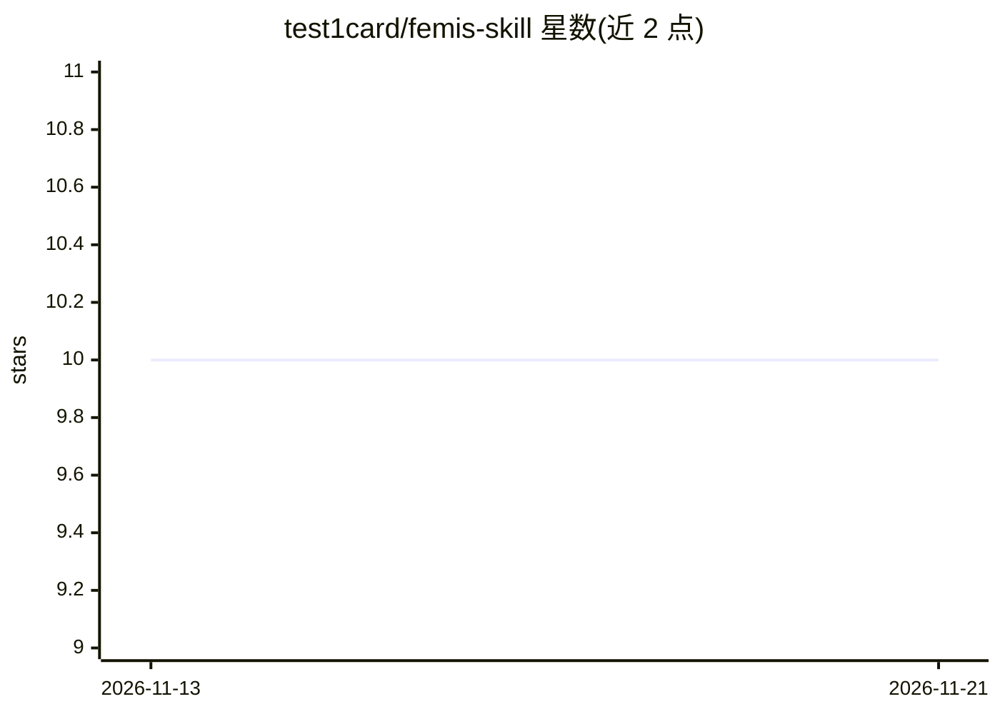

# test1card/femis-skill

⭐ 10 · Python · Apache-2.0 · 推送 2026-10-09 · [GitHub](https://github.com/test1card/femis-skill) · [官网](https://github.com/test1card/femis-skill) · 个人维护

**给 AI agent 用的 FEM/CAE 治理技能：网格无关性与 V&V 纪律**

一个文本可移植的 Agent Skill（SKILL.md + references/ + 无依赖 Python 脚本），把 AI 编码 agent 约束为有纪律的有限元分析师。核心机制包括 GCI 网格无关性检查、ASME V&V 10/20/40 对齐的验证确认层、SMOKE/DEBUG/ENGINEERING/SIGNOFF 执行模式门控，以及 headless 自动化与人工 GUI 操作的契约划分。本体是治理/决策层而非求解器驱动，需搭配 PyMAPDL、OpenFOAM MCP 等执行器使用。主要在 Claude Code 与 OpenAI Codex 下测试，个人/项目级通过复制或 git clone 安装到 skills 目录。

## 筛选速览

| 维度 | 判定 | 备注 |
|---|---|---|
| AI 角色 | `ai-ecosystem` | LLM/agent 周边工具 |
| 许可风险 | `permissive` | Apache-2.0 |
| 部署形态 | `None` |  |
| 模型依赖 | — | README 未给出锁定关系 |
| 硬件要求 | — | 无带数字的原话,不猜 |
| 安装摩擦 | `low` | 无编译、无系统依赖或容器化 |
| 成熟度 | — | 结构信号不足 |

## 能力要点

- GCI 网格无关性检查与 pre-claim 自检模板
- SMOKE/DEBUG/ENGINEERING/SIGNOFF 四级执行模式门控
- headless-vs-human 契约：明确 agent 可自动运行与需人工 GUI 完成的边界
- 无依赖 Python 3.10+ stdlib 计算器（GCI、y+、units、rainflow 等）

## 适用场景

- 让 agent 做网格无关性研究并给出收敛证据
- 自动化热接触等仿真时避免 headless 模式下算得出但算错的情况
- 为 sign-off 级别的工程结论准备证据包交人工审核

## 场景标签

 · 领域:工程仿真/CAE 治理

## 证据(README 行号)

> L8: > It is a **governance / decision layer, not a solver driver**. The entrypoint `SKILL.md` is plain instruction text 
> L39: **How it fits.** femis is the *methodology / decision layer*, not a solver driver. Pair it with an executor (PyMAPD

## 星数曲线

2026-11-13 10 → 2026-11-21 10（+0）

---
*卡片 v1 · prompt 1.4 · 生成 2026-11-19 · 置信度 high · 依据 README sha `5e64c54dae70` · [字段定义](../../DATASET.md)*
