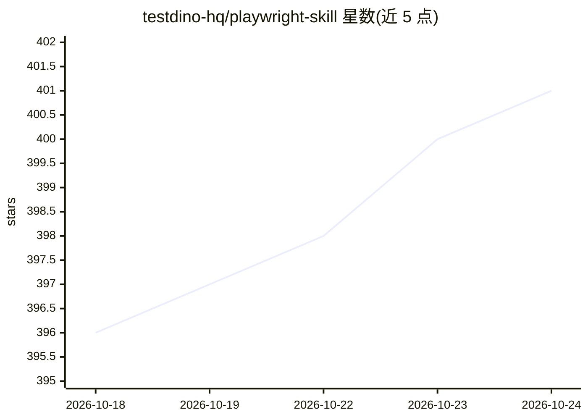

# testdino-hq/playwright-skill

⭐ 401 · MIT · 推送 2026-10-12 · [GitHub](https://github.com/testdino-hq/playwright-skill) · [官网](https://www.testdino.com) · 组织维护

**面向 AI 编程 agent 的 Playwright 测试技能指南包（79 篇）**

由 testdino.com 维护的 Playwright Agent Skills 集合：79 篇 Markdown 指南覆盖 E2E、API、组件、视觉、无障碍与安全测试及 CI/CD、CLI 自动化、trace 调试、页面对象模型与迁移，配 TypeScript/JavaScript 示例，内容更新至 Playwright 1.64。指南以 SKILL.md 为索引，供 AI 编程 agent 按需加载，通过 `npx skills add` 命令安装为 7 个技能包（core/qa/frontend/ci/playwright-cli/migration/pom）。MIT 许可。

## 筛选速览

| 维度 | 判定 | 备注 |
|---|---|---|
| AI 角色 | `ai-knowledge` | 知识聚合/清单类 |
| 许可风险 | `permissive` | MIT |
| 部署形态 | `library` | 以包/库形式分发 |
| 模型依赖 | — | README 未给出锁定关系 |
| 硬件要求 | — | 无带数字的原话,不猜 |
| 安装摩擦 | `low` | 无编译、无系统依赖或容器化 |
| 成熟度 | — | 结构信号不足 |

## 能力要点

- 79 篇指南，含 TypeScript 示例，覆盖至 Playwright 1.64 新特性
- 7 个技能包（core/qa/frontend/ci/playwright-cli/migration/pom）按需安装
- SKILL.md 作为 agent 读取的规范索引，含 Golden Rules
- QA 与 frontend 专属包分别面向测试工程师与前端工程师

## 适用场景

- 让 AI 编程 agent 在编写、调试 Playwright 测试时加载对应指南
- 从 Cypress 或 Selenium 迁移到 Playwright 时获取指引
- QA 工程师将手工用例转换为自动化测试并撰写缺陷报告
- 前端工程师为组件添加稳定可定位的 data-testid

## 场景标签

`教程课程` · 领域:学习与行业

## 证据(README 行号)

> L33: Production-tested Playwright guides for E2E, API, component, visual, accessibility, and security testing, plus CI/C
> L35: These are Agent Skills — Markdown guides an AI coding agent loads on demand. Install them with the `skills` CLI and

## 星数曲线

2026-10-18 396 → 2026-10-24 401（+5）

---
*卡片 v1 · prompt 1.4 · 生成 2026-10-21 · 置信度 high · 依据 README sha `50be243eeb60` · [字段定义](../../DATASET.md)*
