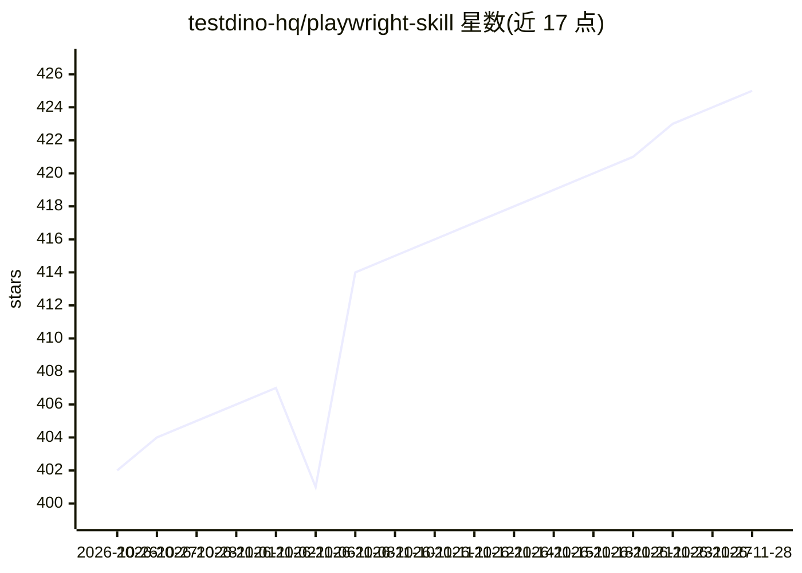

# testdino-hq/playwright-skill

⭐ 425 · MIT · 推送 2026-11-25 · [GitHub](https://github.com/testdino-hq/playwright-skill) · [官网](https://www.testdino.com) · 组织维护

**给 AI 编码代理加载的 79 篇 Playwright 测试最佳实践指南**

一组以 Markdown 形式发布的 Agent Skills：覆盖 E2E、API、组件、视觉、无障碍与安全测试，以及 CI/CD、CLI 自动化、trace 调试、页面对象与迁移等 79 篇指南，附 TypeScript 示例。通过 skills CLI 安装后，AI 编码代理按需读取 SKILL.md 索引，在编写、调试或扩展 Playwright 测试时拉取对应指南。内容跟踪至 Playwright 1.65 的新特性与破坏性变更；MIT 许可，由 testdino.com 维护。

## 筛选速览

| 维度 | 判定 | 备注 |
|---|---|---|
| AI 角色 | `ai-knowledge` | 知识聚合/清单类 |
| 许可风险 | `permissive` | MIT |
| 部署形态 | `library` | 以包/库形式分发 |
| 模型依赖 | — | README 未给出锁定关系 |
| 硬件要求 | — | 无带数字的原话,不猜 |
| 安装摩擦 | `low` | 无编译、无系统依赖或容器化 |
| 成熟度 | — | 结构信号不足 |

## 能力要点

- 79 篇指南分 7 个技能包（core/qa/frontend/ci/playwright-cli/pom/migration）
- SKILL.md 作为代理读取的规范索引，含 Golden Rules 与架构决策指南
- 覆盖 Playwright 1.65 新特性并标注破坏性变更
- npx skills add 一条命令安装全部或单个技能包

## 适用场景

- 让 AI 编码代理按最佳实践生成或修复 Playwright 测试
- QA 工程师将手工用例转为自动化测试
- 将 Cypress 或 Selenium 测试迁移到 Playwright
- 为 GitHub Actions/GitLab CI 等配置 Playwright 流水线

## 场景标签

`浏览器自动化` `代码生成` · 领域:效率与自动化

## 证据(README 行号)

> L33: Production-tested Playwright guides for E2E, API, component, visual, accessibility, and security testing, plus CI/C
> L35: These are Agent Skills — Markdown guides an AI coding agent loads on demand. Install them with the `skills` CLI and

## 星数曲线

2026-10-26 402 → 2026-11-28 425（+23）

---
*卡片 v1 · prompt 1.4 · 生成 2026-11-26 · 置信度 high · 依据 README sha `91f952d479f6` · [字段定义](../../DATASET.md)*
