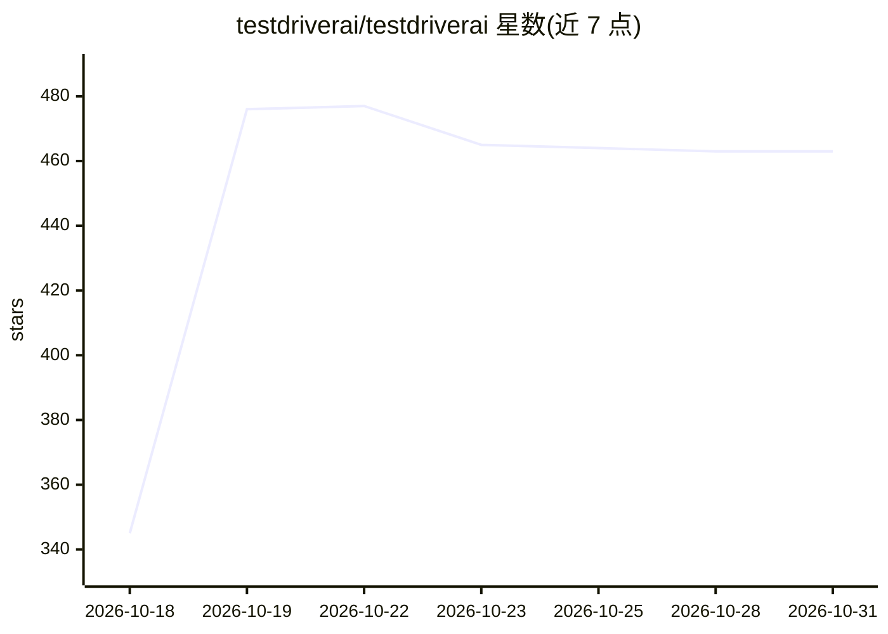

# testdriverai/testdriverai

⭐ 463 · JavaScript · 推送 2026-09-21 · [GitHub](https://github.com/testdriverai/testdriverai) · [官网](https://testdriver.ai) · 组织维护

**面向 E2E 测试的 Computer-Use SDK，用视觉 LLM 驱动测试**

TestDriver SDK 是一个 vitest 的 JS 插件，用于生成端到端测试：通过云端沙箱启动临时设备与 Chrome，由视觉 LLM 执行测试步骤并返回带视频回放的结果。定位为传统工具难以覆盖的场景（第三方 Web 应用、桌面应用、VS Code 扩展、OAuth 流程、PDF 内容、iframe/canvas 等）提供测试、调试与监控。使用需创建 TestDriver 账号，通过 npx testdriverai init 初始化项目并配置 API key，可同时为 AI 助手配置 MCP。

## 筛选速览

| 维度 | 判定 | 备注 |
|---|---|---|
| AI 角色 | `ai-ecosystem` | LLM/agent 周边工具 |
| 许可风险 | `none` | — |
| 部署形态 | `library` | 以包/库形式分发 |
| 模型依赖 | — | README 未给出锁定关系 |
| 硬件要求 | — | 无带数字的原话,不猜 |
| 安装摩擦 | `low` | 无编译、无系统依赖或容器化 |
| 成熟度 | — | 结构信号不足 |

## 能力要点

- vitest 插件形式，通过 npx 一条命令初始化项目
- 视觉 LLM 在云端沙箱中运行测试，返回视频回放
- 支持桌面应用、浏览器扩展、iframe/canvas 等难测场景
- 初始化时自动为 VS Code/Cursor/Claude Desktop 等配置 MCP

## 适用场景

- 为第三方 Web 应用和桌面应用编写 E2E 测试
- 覆盖 OAuth 流程、文件上传等传统工具难测的场景
- 通过视频回放调试测试失败原因

## 场景标签

`浏览器自动化` `GUI 自动化` · 领域:效率与自动化

## 证据(README 行号)

> L7:  The TestDriver SDK is a JS plugin for vitest that makes it easy to spawn ephemeral devices and use vision-based LLM
> L60: 3. Runs your test using AI vision

## 星数曲线

2026-10-18 345 → 2026-10-31 463（+118）

---
*卡片 v1 · prompt 1.4 · 生成 2026-10-21 · 置信度 high · 依据 README sha `f2104d5bc867` · [字段定义](../../DATASET.md)*
