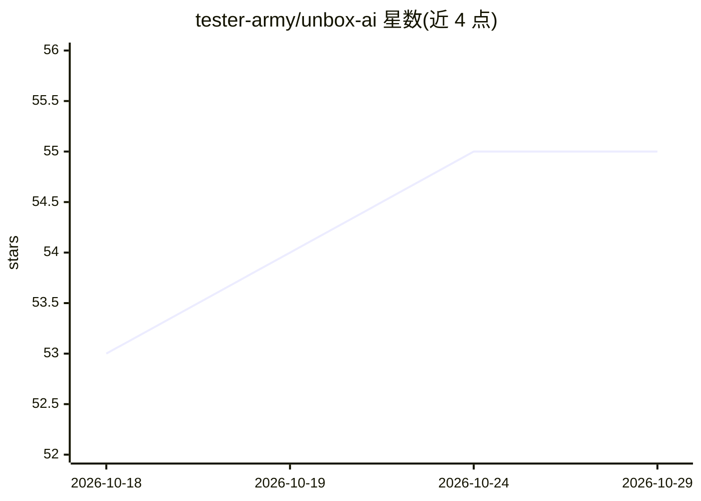

# tester-army/unbox-ai

⭐ 55 · TypeScript · MIT · 推送 2026-10-25 · [GitHub](https://github.com/tester-army/unbox-ai) · [官网](https://tester.army) · 个人维护

**AI agent 追踪可视化工具：token、延迟与成本一目了然**

面向开发者的命令行工具，把 AI agent 的 trace 文件转为本地浏览器可视化：输入 token 按系统提示、工具定义、消息分组的 treemap，带 TTFT 的延迟瀑布图，以及去重对话视图。同一二进制还充当有界只读的 trace 浏览器，供编码 agent 安全调用（输出限量、--json、不误启服务器），并提供 prompt/模型 A/B 对比与按模型聚合的 summary。支持网关导出、opencode 会话导出与 AI SDK devtools 数据库三种格式，token 归因为字符比例估算。通过 npm/npx 分发，附 agent skill 安装方式。

## 筛选速览

| 维度 | 判定 | 备注 |
|---|---|---|
| AI 角色 | `ai-ecosystem` | LLM/agent 周边工具 |
| 许可风险 | `permissive` | MIT |
| 部署形态 | `library` | 以包/库形式分发 |
| 模型依赖 | — | README 未给出锁定关系 |
| 硬件要求 | — | 无带数字的原话,不猜 |
| 安装摩擦 | `low` | 无编译、无系统依赖或容器化 |
| 成熟度 | — | 结构信号不足 |

## 能力要点

- 输入 token treemap（系统提示/工具定义/消息归属，可切累计与成本视图）
- 延迟瀑布图（TTFT、tokens、每代成本）与去重对话视图
- agent 安全 CLI：限量输出、--json、非 TTY 不启服务器
- unbox-ai devtools 可替代 @ai-sdk/devtools viewer 做实时流式观测

## 适用场景

- 分析 agent 运行中 token 与成本花在哪里
- 对比 prompt 或模型变更前后的两次运行
- 让编码 agent 以只读方式检索和汇总 trace 文件
- 实时观测 AI SDK 应用的 generateText/streamText 调用

## 场景标签

`LLM 可观测性` · 领域:评测与运维

## 证据(README 行号)

> L16: unbox-ai turns an AI agent trace into something you can read. One command opens
> L56: ## AI SDK DevTools (live)

## 星数曲线

2026-10-18 53 → 2026-10-29 55（+2）

---
*卡片 v1 · prompt 1.4 · 生成 2026-10-24 · 置信度 high · 依据 README sha `3ed643cd13a7` · [字段定义](../../DATASET.md)*
