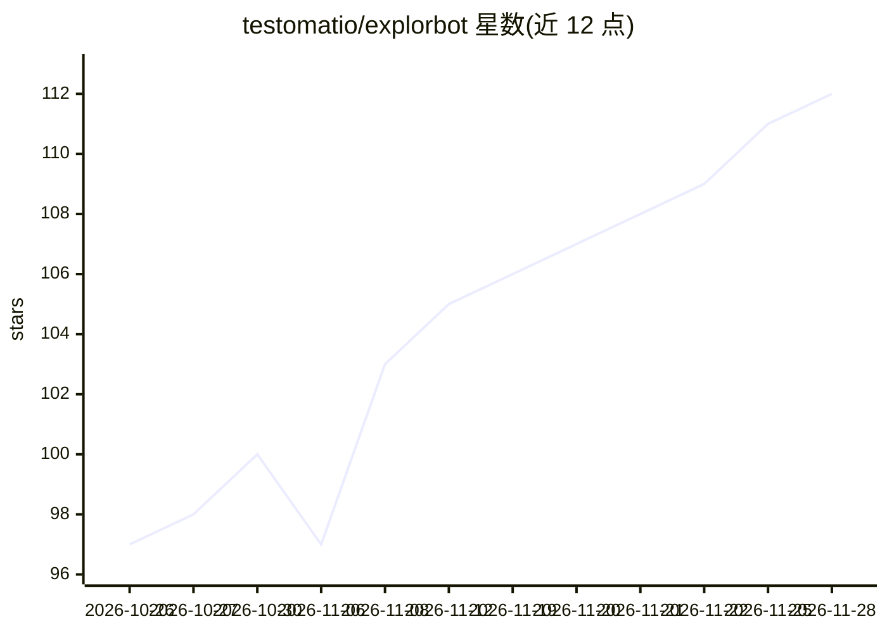

# testomatio/explorbot

⭐ 112 · TypeScript · NOASSERTION · 推送 2026-11-24 · [GitHub](https://github.com/testomatio/explorbot) · [官网](https://testomat.ai/explorbot/) · 组织维护

**AI 代理自动对 Web 应用做探索式测试并生成测试用例**

面向 Web 应用的探索式测试 AI 代理：给定 URL 和目标后，由多代理协作完成研究页面结构、规划测试场景、逐步驱动浏览器、验证结果并保留通过流程为 Playwright 或 CodeceptJS 测试，同时输出 HTML/Markdown 报告与录屏。流程决策确定性、点击细节由 AI 决定；不同角色代理分别使用低成本与高能力模型。通过 Vercel AI SDK 支持多种 AI 提供商，全部运行在本地与 CI，无需云服务；以 npm 包分发，需 Node.js 24+ 或 Bun 及 AI 提供商 API key。

## 筛选速览

| 维度 | 判定 | 备注 |
|---|---|---|
| AI 角色 | `ai-native` | 本体是模型或模型工具 |
| 许可风险 | `none` | NOASSERTION |
| 部署形态 | `library` | 以包/库形式分发 |
| 模型依赖 | locked-api |  |
| 硬件要求 | — | 无带数字的原话,不猜 |
| 安装摩擦 | `low` | 无编译、无系统依赖或容器化 |
| 成熟度 | — | 结构信号不足 |

## 能力要点

- 多代理分工：Researcher/Planner/Tester 等九个角色协作执行测试循环
- 通过的流程保存为 Playwright 或 CodeceptJS 测试用例，可提交到 CI
- 分层模型策略：低成本模型执行点击读取，高能力模型做决策
- 通过 OpenAPI 规范支持 REST API 测试

## 适用场景

- 对 MVP 和原型做快速探索式测试发现隐藏缺陷
- 为无覆盖的新功能自动生成基础测试用例
- 在 CI 中与既有回归测试并行运行 24/7 随机探索
- 从网站探索中生成手工测试用例文档

## 场景标签

`浏览器自动化` `代码审查` `多智能体` · 领域:Agent 开发

## 证据(README 行号)

> L7: Explorbot is an AI agent that investigates your product like your most relentless QA engineer — clicking around, fil
> L41: Give Explorbot a goal and a URL. A crew of agents takes it from there — no scripts, no human in the loop.
> L15: Explorbot works with any AI provider through the Vercel AI SDK. See `models.json` for the current recommended provi

## 星数曲线

2026-10-26 97 → 2026-11-28 112（+15）

---
*卡片 v1 · prompt 1.4 · 生成 2026-11-28 · 置信度 high · 依据 README sha `0c66018c0bdd` · [字段定义](../../DATASET.md)*
