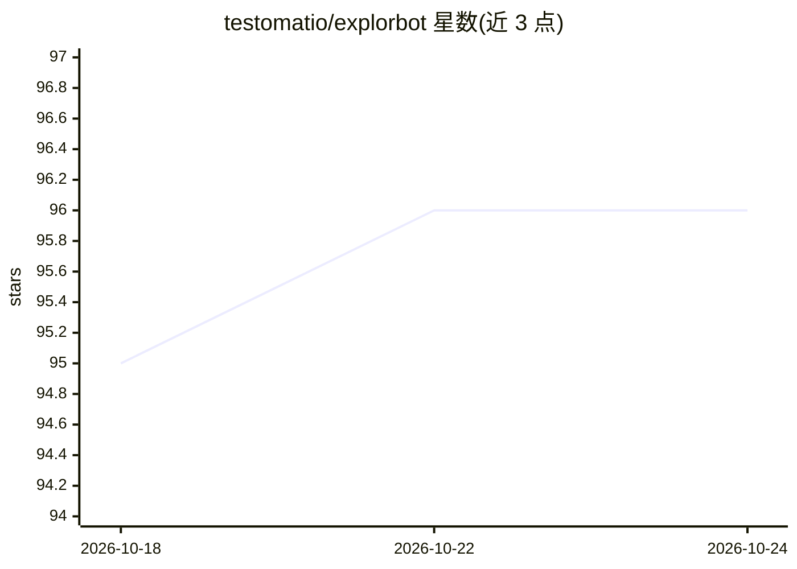

# testomatio/explorbot

⭐ 97 · TypeScript · NOASSERTION · 推送 2026-10-22 · [GitHub](https://github.com/testomatio/explorbot) · [官网](https://testomat.ai/explorbot/) · 组织维护

**AI agent 自主探索式测试 Web 应用并沉淀可复用测试**

基于 Playwright 的探索式浏览器测试 agent：给定 URL 与目标后，多 agent 分工执行研究、规划、执行、验证流程，自动点击、填表、发现缺陷，并将通过的流程保存为 Playwright 或 CodeceptJS 测试、HTML/Markdown 报告与录屏。支持任意 Vercel AI SDK 接入的模型提供商，可读取 OpenAPI 规格测试 REST API，运行于本地与 CI，无 GPU 要求。需 Node.js 24+ 或 Bun、AI 提供商 API key 与现代终端，采用 Elastic License 2.0（非 OSI 开源许可证）。

## 筛选速览

| 维度 | 判定 | 备注 |
|---|---|---|
| AI 角色 | `ai-native` | 本体是模型或模型工具 |
| 许可风险 | `none` | NOASSERTION |
| 部署形态 | `library` | 以包/库形式分发 |
| 模型依赖 | — | README 未给出锁定关系 |
| 硬件要求 | — | 无带数字的原话,不猜 |
| 安装摩擦 | `low` | 无编译、无系统依赖或容器化 |
| 成熟度 | — | 结构信号不足 |

## 能力要点

- 多 agent 流程：研究→规划→执行→验证→沉淀测试
- 产出可提交 CI 的 Playwright/CodeceptJS 测试与报告、录屏
- 经 Vercel AI SDK 支持多家 AI 提供商（OpenRouter 推荐）
- 从 OpenAPI 规格生成并执行 REST API 测试

## 适用场景

- 给零覆盖的新功能快速生成基础测试用例并执行
- 24/7 自动探索式测试，发现脚本测试覆盖不到的缺陷
- 在 CI 中与其他测试层并行运行探索式测试

## 场景标签

`多智能体` `浏览器自动化` · 领域:Agent 开发

## 证据(README 行号)

> L7: Explorbot is an AI agent that investigates your product like your most relentless QA engineer — clicking around, fil
> L41: Give Explorbot a goal and a URL. A crew of agents takes it from there — no scripts, no human in the loop.

## 星数曲线

2026-10-18 95 → 2026-10-24 96（+1）

---
*卡片 v1 · prompt 1.4 · 生成 2026-10-23 · 置信度 high · 依据 README sha `fd1578234e81` · [字段定义](../../DATASET.md)*
