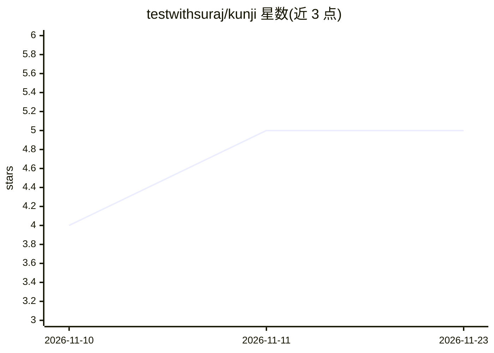

# testwithsuraj/kunji

⭐ 5 · Python · Apache-2.0 · 推送 2026-11-22 · [GitHub](https://github.com/testwithsuraj/kunji) · [官网](http://kunji.iamsuraj.me) · 个人维护

**BYOK 终端 AI 聊天客户端：接入多家模型并跟踪费用与预算**

终端 AI 聊天工具，用户使用自己的 API key 直接对接各家模型服务商，工具本身不经手密钥与对话。内置实时费用显示、按天预算（80% 告警、100% 拦截）、对话中切换模型、多模型并排对比、限流自动回退、管道输入、保存提示词与聊天历史。密钥存于操作系统凭据库，用量数据仅存本地。安装脚本基于 uv（自动装 Python 3.11+），另提供 pip/pipx/单文件二进制。未来 Pro 计划为可选云功能。

## 筛选速览

| 维度 | 判定 | 备注 |
|---|---|---|
| AI 角色 | `ai-ecosystem` | LLM/agent 周边工具 |
| 许可风险 | `permissive` | Apache-2.0 |
| 部署形态 | `desktop` | 安装包/桌面程序 |
| 模型依赖 | local-ok | 支持本地模型 |
| 硬件要求 | — | 无带数字的原话,不猜 |
| 安装摩擦 | `low` | 无编译、无系统依赖或容器化 |
| 成熟度 | — | 结构信号不足 |

## 能力要点

- 对话中 /model 切换模型并保留上下文
- 实时费用计量与每日预算（80% 告警、100% 拦截）
- 密钥存于 OS 凭据库，用量数据仅本地保存
- compare 模式同一提示词并排对比多模型并标出最快/最便宜

## 适用场景

- 用一套命令行工具管理多家 API key 的模型对话
- 控制 AI API 日开销并查看每个回答的费用
- 同时对比多个模型对同一提示词的输出
- 把管道输出交给 AI 分析（如测试报错）

## 场景标签

`聊天机器人` · 领域:对话与助手

## 证据(README 行号)

> L21: Kunji is a terminal app for chatting with any AI model using **your own API keys**.
> L26: - **One tool, every provider.** OpenAI, Anthropic, Google Gemini, Groq, OpenRouter,
> L31: - **Daily budgets.** Warns at 80%, blocks at 100%, per provider or overall.

## 星数曲线

2026-11-10 4 → 2026-11-23 5（+1）

---
*卡片 v1 · prompt 1.4 · 生成 2026-11-21 · 置信度 high · 依据 README sha `f1cb7ee87e3a` · [字段定义](../../DATASET.md)*
