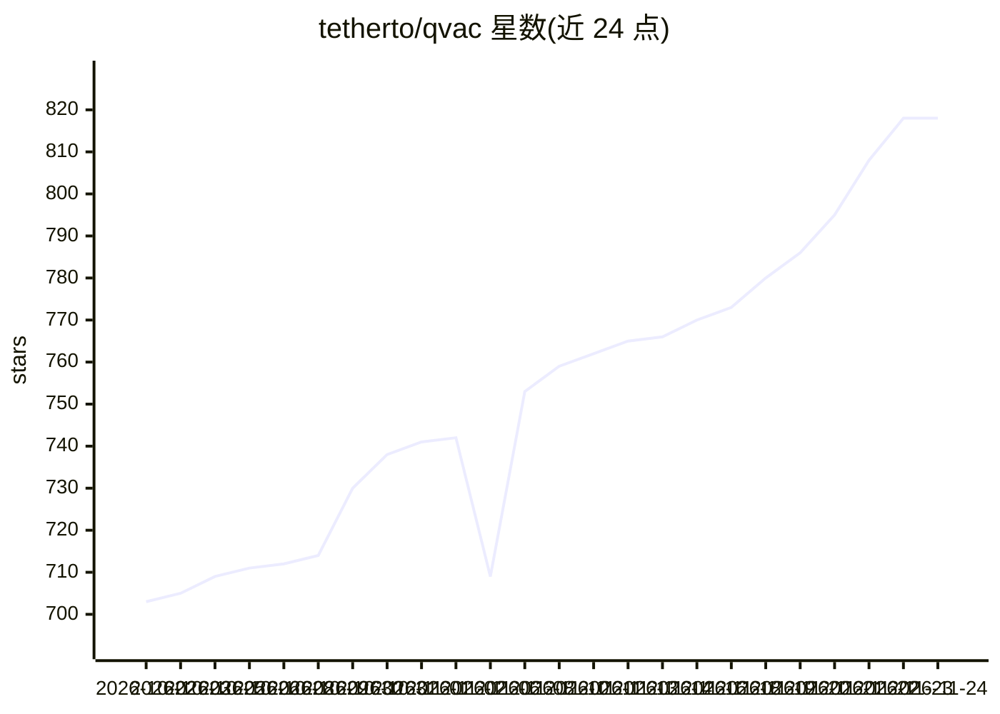

# tetherto/qvac

⭐ 818 · TypeScript · Apache-2.0 · 推送 2026-11-22 · [GitHub](https://github.com/tetherto/qvac) · [官网](https://qvac.tether.io) · 组织维护

**在本地设备运行多种 AI 工作负载的开源 SDK**

面向开发者的本地优先 AI SDK：提供 JavaScript/TypeScript 与 Python 客户端，以及带 OpenAI 兼容 API 的本地 HTTP 服务器，可作为模型提供方接入 OpenCode、OpenClaw 等工具。能力覆盖文本生成、嵌入、RAG、LoRA 微调、多模态推理、图像/视频/音乐生成、语音转写、说话人分离、TTS、翻译、OCR、BCI 与 VLA。内置 P2P 模型分发与盲中继，可在 NAT/防火墙环境下不经中心化基础设施获取模型。跨 Linux/macOS/Windows/Android/iOS。

## 筛选速览

| 维度 | 判定 | 备注 |
|---|---|---|
| AI 角色 | `ai-ecosystem` | LLM/agent 周边工具 |
| 许可风险 | `permissive` | Apache-2.0 |
| 部署形态 | `library` | 以包/库形式分发 |
| 模型依赖 | — | README 未给出锁定关系 |
| 硬件要求 | — | 无带数字的原话,不猜 |
| 安装摩擦 | `medium` | 含编译或系统依赖之一 |
| 成熟度 | — | 结构信号不足 |

## 能力要点

- JS/TS 与 Python 双 SDK，附 OpenAI 兼容 HTTP 服务器（默认 127.0.0.1:11435）
- 任务表覆盖生成、嵌入、RAG、LoRA 微调、多模态、图像/视频/音乐生成、转写、TTS、OCR、BCI、VLA
- P2P 模型注册表直接从对等节点下载模型，含盲中继路由
- 跨 Linux、macOS、Windows、Android、iOS 五平台单一代码库

## 适用场景

- 在无网络/无云端 API 的设备上本地运行 LLM 推理
- 为本地 AI 应用提供统一的多模态与语音 SDK
- 把本地模型作为 OpenAI 兼容提供方接入现有 AI 工具
- 构建点对点分发模型的去中心化应用

## 场景标签

`模型网关` `RAG` `语音识别` `语音合成` · 领域:Agent 开发

## 证据(README 行号)

> L31: - **SDK** for building local-first AI applications and systems in JavaScript/TypeScript and Python.
> L32: - **HTTP server** for using QVAC as a local model provider. Its OpenAI-compatible API lets you connect AI tools suc

## 星数曲线

2026-10-22 703 → 2026-11-24 818（+115）

---
*卡片 v1 · prompt 1.4 · 生成 2026-11-24 · 置信度 high · 依据 README sha `c4f3bda858b1` · [字段定义](../../DATASET.md)*
