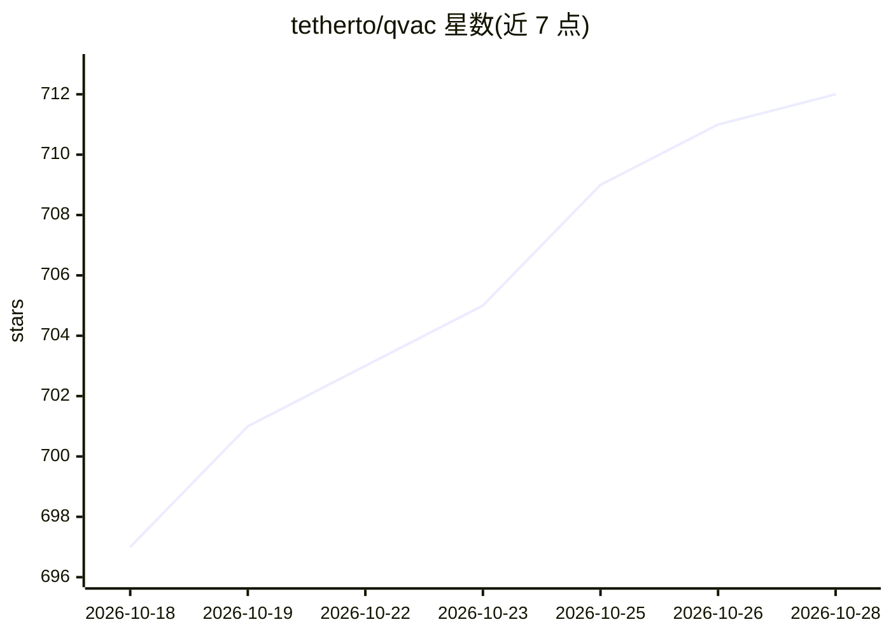

# tetherto/qvac

⭐ 712 · TypeScript · Apache-2.0 · 推送 2026-10-27 · [GitHub](https://github.com/tetherto/qvac) · [官网](https://qvac.tether.io) · 组织维护

**跨平台本地 AI SDK：在五类系统上离线运行 LLM 等多种 AI 工作负载**

由 Tether 维护的开源本地 AI SDK 与模型提供方：通过 JavaScript/TypeScript 与 Python SDK 构建本地优先应用，支持文本生成、嵌入、RAG、LoRA 微调、图像/视频/音乐生成、语音转文本与说话人分离、OCR、翻译、VLA 等。附带 HTTP 服务器，暴露 OpenAI 兼容 API 供 OpenCode 等工具接入。内置 P2P 能力可从分布式注册表直接在节点间下载模型。覆盖 Linux/macOS/Windows/Android/iOS。

## 筛选速览

| 维度 | 判定 | 备注 |
|---|---|---|
| AI 角色 | `ai-ecosystem` | LLM/agent 周边工具 |
| 许可风险 | `permissive` | Apache-2.0 |
| 部署形态 | `library` | 以包/库形式分发 |
| 模型依赖 | — | README 未给出锁定关系 |
| 硬件要求 | — | 无带数字的原话,不猜 |
| 安装摩擦 | `medium` | 含编译或系统依赖之一 |
| 成熟度 | — | 结构信号不足 |

## 能力要点

- 一套 SDK 覆盖文本、多模态、图像/视频/音乐生成、转写、OCR 等本地推理
- HTTP 服务器提供 OpenAI 兼容 API，可接入各类 AI 工具
- P2P 分布式模型注册表，节点间直接下载模型
- 单代码库跨 Linux/macOS/Windows/Android/iOS 五平台

## 适用场景

- 在移动与桌面应用中集成离线 AI 能力
- 把 QVAC 作为本地模型提供方接入 OpenAI 兼容工具
- 在无云、无 API key 的环境运行 LLM 推理与 RAG

## 场景标签

`模型网关` `RAG` `语音识别` `图像生成` · 领域:Agent 开发

## 证据(README 行号)

> L31: - **SDK** for building local-first AI applications and systems in JavaScript/TypeScript and Python.
> L32: - **HTTP server** for using QVAC as a local model provider. Its OpenAI-compatible API lets you connect AI tools suc
> L130: Launch the server with the CLI, then use QVAC as model provider for OpenAI-compatible tools like OpenCode and Open

## 星数曲线

2026-10-18 697 → 2026-10-28 712（+15）

---
*卡片 v1 · prompt 1.4 · 生成 2026-10-21 · 置信度 high · 依据 README sha `9df10882eefd` · [字段定义](../../DATASET.md)*
