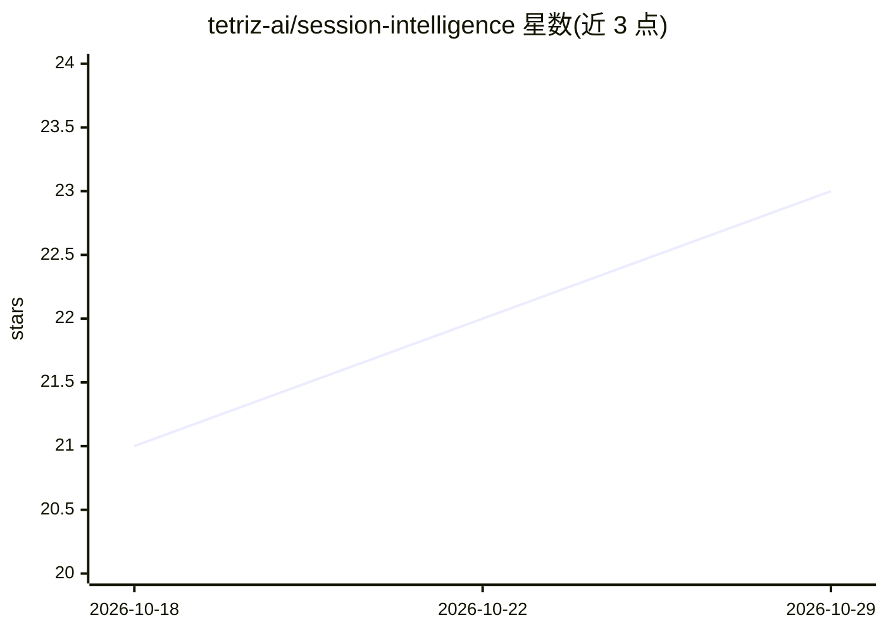

# tetriz-ai/session-intelligence

⭐ 23 · Go · MIT · 推送 2026-10-22 · [GitHub](https://github.com/tetriz-ai/session-intelligence) · [官网](https://github.com/tetriz-ai/session-intelligence#readme) · 组织维护

**分析 AI 编码助手会话记录的 Go 引擎：给出提示质量与安全判定**

读取归一化的编码 agent 会话记录（Codex/Claude Code/Cursor/Copilot/Kiro/Antigravity，经配套 extractor 提取），调用用户自备的 LLM 生成结构化分析：会话判定、逐轮评价（目标达成、失败类别、浪费原因）、阶段 went_well/went_wrong、清晰度/上下文等评分，以及暴露密钥与个人数据的安全标记。自带 Gemini 的 reference 服务，可换模型；无仪表盘、不做跨会话自动追踪。以 Go 库与 CLI 形式提供，支持嵌入产品（接口注入依赖、Postgres 批处理）。

## 筛选速览

| 维度 | 判定 | 备注 |
|---|---|---|
| AI 角色 | `ai-ecosystem` | LLM/agent 周边工具 |
| 许可风险 | `permissive` | MIT |
| 部署形态 | `self-host` | docker 或自建部署 |
| 模型依赖 | — | README 未给出锁定关系 |
| 硬件要求 | — | 无带数字的原话,不猜 |
| 安装摩擦 | `low` | 无编译、无系统依赖或容器化 |
| 成熟度 | — | 结构信号不足 |

## 能力要点

- 对归一化会话记录产出逐轮/阶段/整场的结构化 JSON 分析
- 安全标记：暴露的 API key、数据库凭据与个人数据
- Bring your own LLM：Provider 接口注入模型，自带 Gemini reference 服务
- 包级 Go API 可嵌入，依赖以接口传入，无全局副作用；Prometheus 指标可选注册

## 适用场景

- 复盘自己的 AI 编码会话，定位提示缺上下文或反复返工的环节
- 团队对编码 agent 会话做质量与 token 效率的观测分析
- 在自有产品中嵌入会话分析，用自备模型与存储跑批处理
- 检出会话记录中暴露的密钥与个人数据

## 场景标签

`LLM 可观测性` · 领域:评测与运维

## 证据(README 行号)

> L1: session-intelligence: derive turns, phases, outcomes and security flags from a coding-agent session transcript
> L135: The CLI returns structured JSON; it does not provide a dashboard or automatically track habits across sessions. Re
> L178: Every entry point is package-level Go, and each dependency is passed in as an interface. Importing the engine has 

## 星数曲线

2026-10-18 21 → 2026-10-29 23（+2）

---
*卡片 v1 · prompt 1.4 · 生成 2026-10-27 · 置信度 mid · 依据 README sha `8cf6e377c65d` · [字段定义](../../DATASET.md)*
