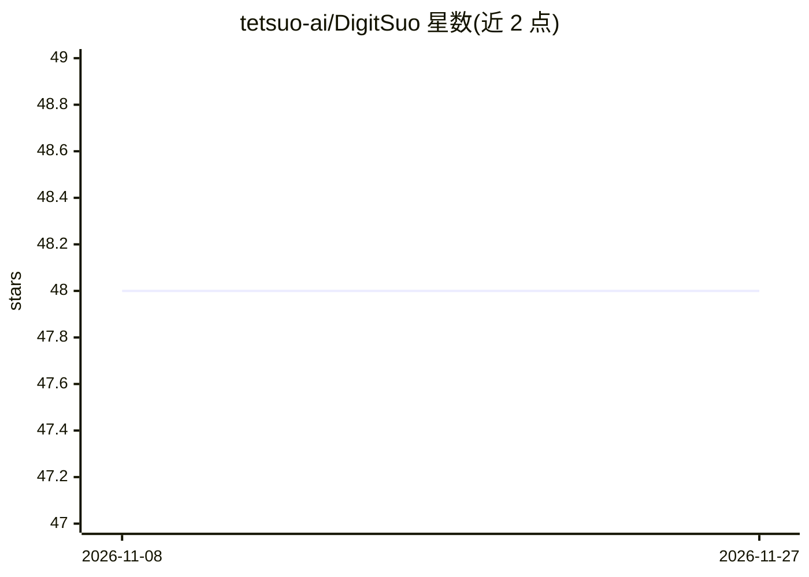

# tetsuo-ai/DigitSuo

⭐ 48 · C · MIT · 推送 2026-11-04 · [GitHub](https://github.com/tetsuo-ai/DigitSuo) · 个人维护

**C 语言手写数字识别系统：含训练与交互式识别界面**

纯 C 实现的神经网络手写数字识别项目：784 输入层加隐藏层的全连接网络（ReLU 激活），通过 Makefile 构建，提供训练程序（数据增强、动量梯度下降、学习率衰减、早停、OpenMP 并行）与基于 ncurses 的交互式绘图识别界面，用户用鼠标绘制数字后提交识别。训练读取 MNIST 数据集（zlib 解压），推理延迟 <10ms、内存约 2MB。README 另含 Solana 代币合约地址信息。

## 筛选速览

| 维度 | 判定 | 备注 |
|---|---|---|
| AI 角色 | `ai-native` | 本体是模型或模型工具 |
| 许可风险 | `permissive` | MIT |
| 部署形态 | `None` |  |
| 模型依赖 | — | README 未给出锁定关系 |
| 硬件要求 | — | 无带数字的原话,不猜 |
| 安装摩擦 | `medium` | 含编译或系统依赖之一 |
| 成熟度 | — | 结构信号不足 |

## 能力要点

- 纯 C 实现的全连接神经网络，MNIST 测试集训练准确率 >98%
- 交互式绘图界面，鼠标绘制数字实时识别
- 训练管线含数据增强（旋转/平移/高斯模糊）、早停与 OpenMP 并行
- 推理延迟 <10ms，内存占用约 2MB

## 适用场景

- 学习神经网络从零用 C 实现的原理
- 在手绘图上交互式测试手写数字识别
- 作为 MNIST 基线的本地训练实验项目

## 场景标签

`目标检测` `教程课程` · 领域:学习与行业

## 证据(README 行号)

> L10: A neural network–based digit recognition project using the MNIST dataset.
> L128: - Training accuracy: >98% on the MNIST test set.

## 星数曲线

2026-11-08 48 → 2026-11-27 48（+0）

---
*卡片 v1 · prompt 1.4 · 生成 2026-11-18 · 置信度 high · 依据 README sha `0618a0c43d26` · [字段定义](../../DATASET.md)*
