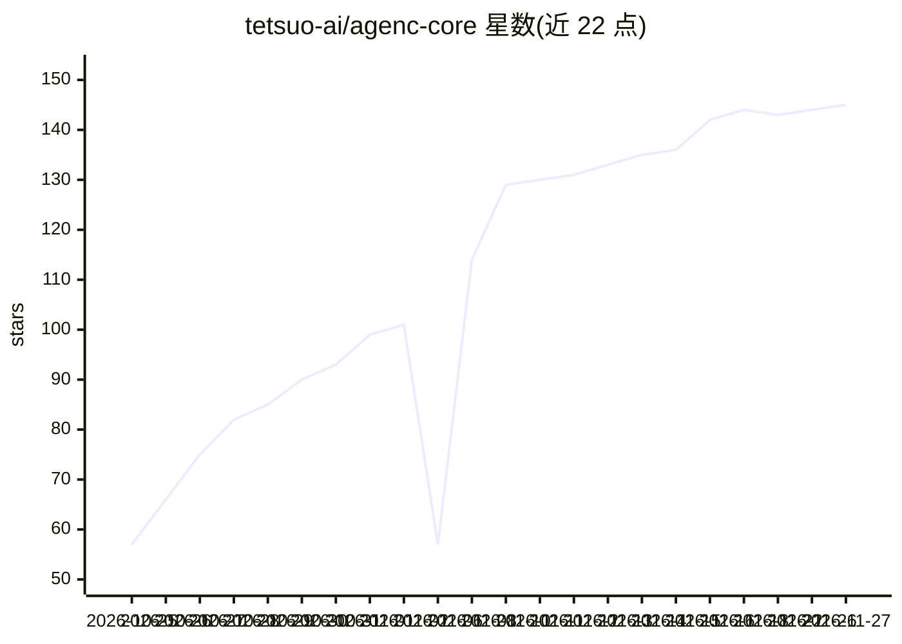

# tetsuo-ai/agenc-core

⭐ 145 · TypeScript · MIT · 推送 2026-11-23 · [GitHub](https://github.com/tetsuo-ai/agenc-core) · [官网](https://get.agenc.ag) · 组织维护

**终端编码 agent CLI：让任意模型规划、用工具并自检**

AgenC Core 是终端内的编码 agent，也是 `agenc` CLI 的实现仓库。架构为 launcher→daemon→多客户端：交互式 React TUI、headless 单次模式、后台 agent 与多通道网关（Telegram/Discord/Slack/WebChat）都挂在同一 daemon 上。内置 Bash、文件读写编辑、apply_patch、浏览器自动化、MCP 客户端/服务端、子 agent 等工具，带权限模式、可选 OS 沙箱与预算限额执行。支持 17 个内置 provider，默认 grok；持久会话基于 SQLite 与 append-only 日志，可导出轨迹数据。安装用 curl 脚本或 npm；源码构建需 Node.js 与 cc。

## 筛选速览

| 维度 | 判定 | 备注 |
|---|---|---|
| AI 角色 | `ai-ecosystem` | LLM/agent 周边工具 |
| 许可风险 | `permissive` | MIT |
| 部署形态 | `library` | 以包/库形式分发 |
| 模型依赖 | local-ok | 支持本地模型 |
| 硬件要求 | — | 无带数字的原话,不猜 |
| 安装摩擦 | `low` | 无编译、无系统依赖或容器化 |
| 成熟度 | — | 结构信号不足 |

## 能力要点

- 17 个内置 provider，默认 grok-4.6，支持 Grok OAuth 订阅登录
- daemon 进程模型：TUI、headless、后台 agent、通道网关为多客户端
- 内置工具含浏览器自动化（CDP+SSRF 代理）与 MCP 客户端/服务端
- 预算限额执行、权限模式与可选 OS 沙箱（bubblewrap/Landlock/Seatbelt）

## 适用场景

- 在终端里让 agent 定位并修复代码回归，跑测试到通过
- 在脚本与 CI 中用 headless 模式执行一次性编码任务
- 通过 Telegram/Discord/Slack 等通道远程跟进后台 agent
- 用自带预算与权限控制运行长时自动化编码会话

## 场景标签

`编码 Agent` · 领域:编码与开发

## 证据(README 行号)

> L8: Our goal is to multiply model capability per dollar of inference. AgenC is an
> L14: AgenC Core is a coding agent for your terminal. It works with any model
> L94: - **17 built-in providers** — default provider **grok**; fresh-config session

## 星数曲线

2026-10-25 57 → 2026-11-27 145（+88）

---
*卡片 v1 · prompt 1.4 · 生成 2026-11-27 · 置信度 high · 依据 README sha `024136afb4e8` · [字段定义](../../DATASET.md)*
