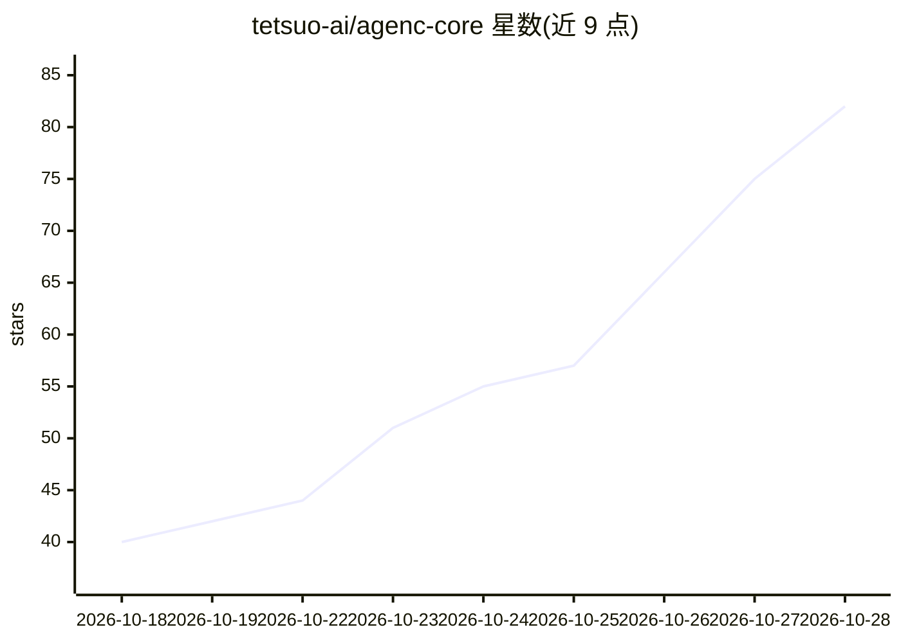

# tetsuo-ai/agenc-core

⭐ 82 · TypeScript · MIT · 推送 2026-10-27 · [GitHub](https://github.com/tetsuo-ai/agenc-core) · [官网](https://get.agenc.ag) · 组织维护

**开源终端 AI 编程 agent，支持 17+ 模型提供商与本地模型**

TypeScript 实现的开源终端 AI 编程代理（agenc CLI），架构为本地 daemon 统一管理 agent/会话生命周期、权限、提供商调用与命令执行，TUI、headless CLI、后台 agent、频道网关与手机远程桥接均作为 daemon 客户端。内置 Bash/文件编辑/浏览器自动化/LSP/MCP 等工具，支持 17 个内置提供商（默认 Grok）及 Ollama、LM Studio 本地模型，提供预算受限执行、分层安全与可选 OS 沙箱。通过安装脚本或 npm 安装，源码构建需 Node.js 26.5+ 与 ripgrep，Linux 源码构建需 C11 编译器。

## 筛选速览

| 维度 | 判定 | 备注 |
|---|---|---|
| AI 角色 | `ai-native` | 本体是模型或模型工具 |
| 许可风险 | `permissive` | MIT |
| 部署形态 | `library` | 以包/库形式分发 |
| 模型依赖 | local-ok | 支持本地模型 |
| 硬件要求 | — | 无带数字的原话,不猜 |
| 安装摩擦 | `low` | 无编译、无系统依赖或容器化 |
| 成熟度 | — | 结构信号不足 |

## 能力要点

- daemon 支撑的进程模型：TUI/headless/后台 agent/网关共用一个控制平面
- 17 个内置提供商，支持 Ollama/LM Studio 本地模型，默认 grok-4.6
- 内置工具含事务性 apply_patch、CDP 浏览器自动化、MCP 客户端与服务端
- Telegram/Discord/Slack/WebChat 频道网关与 iOS/Android 远程控制

## 适用场景

- 在终端用自然语言驱动 agent 修复代码并运行测试
- 在脚本和 CI 中以 headless 模式运行一次性 agent 任务
- 通过 Telegram/Discord 等频道或手机远程跟踪后台 agent

## 场景标签

`编码 Agent` · 领域:编码与开发

## 证据(README 行号)

> L8: An open source AI coding agent for your terminal. It works with any model
> L24: - Bring any model: OpenAI, Anthropic, Grok, Gemini, DeepSeek, OpenRouter and
> L25:  more, or local models through Ollama and LM Studio.

## 星数曲线

2026-10-18 40 → 2026-10-28 82（+42）

---
*卡片 v1 · prompt 1.4 · 生成 2026-10-24 · 置信度 high · 依据 README sha `32dcc68ccf9c` · [字段定义](../../DATASET.md)*
