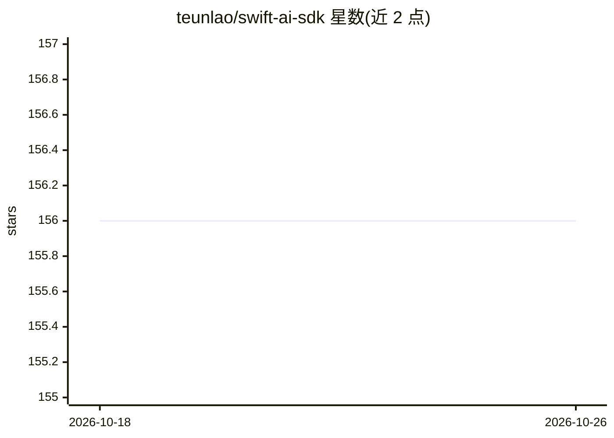

# teunlao/swift-ai-sdk

⭐ 156 · Swift · Apache-2.0 · 推送 2026-10-17 · [GitHub](https://github.com/teunlao/swift-ai-sdk) · [官网](https://swift-ai-sdk-docs.vercel.app) · 个人维护

**面向 Apple 平台的 Swift 统一 AI SDK，单一 API 接 36 家模型商**

为 Swift 开发者提供统一的 LLM 接入层：流式/非流式文本生成、结构化输出（Codable + JSON Schema）、类型化工具/函数调用与 MCP 工具、中间件钩子及实验性视频生成。36 个 provider 各自作为独立 SwiftPM 产品发布（OpenAI、Anthropic、Google、Groq、xAI、TogetherAI 等），切换模型商无需修改调用代码。项目移植自 Vercel AI SDK，目标是行为与 API 对齐，遵循 Apache 2.0 许可。

## 筛选速览

| 维度 | 判定 | 备注 |
|---|---|---|
| AI 角色 | `ai-ecosystem` | LLM/agent 周边工具 |
| 许可风险 | `permissive` | Apache-2.0 |
| 部署形态 | `None` |  |
| 模型依赖 | — | README 未给出锁定关系 |
| 硬件要求 | — | 无带数字的原话,不猜 |
| 安装摩擦 | `low` | 无编译、无系统依赖或容器化 |
| 成熟度 | — | 结构信号不足 |

## 能力要点

- 单一 API 接入 36 个 provider 模块，切换无需改动调用点
- 结构化输出：Codable/JSON Schema 校验，支持对象/数组/枚举生成
- 类型化工具/函数调用与 MCP 工具支持
- 中间件钩子与实验性视频生成

## 适用场景

- 在 iOS/macOS 应用中集成多家 LLM 而不改调用代码
- 让模型生成经 JSON Schema 校验的类型化 Swift 数据结构
- 为 Swift 应用添加带工具调用的 agent 能力

## 场景标签

`模型网关` · 领域:Agent 开发

## 证据(README 行号)

> L9: A unified AI SDK for Swift: streaming chat/completions, structured outputs, tool/function/MCP calling, and middlewar
> L18: - Provider-agnostic API (swap providers without changing call sites)

## 星数曲线

2026-10-18 156 → 2026-10-26 156（+0）

---
*卡片 v1 · prompt 1.4 · 生成 2026-10-22 · 置信度 high · 依据 README sha `811ac99b4f0d` · [字段定义](../../DATASET.md)*
