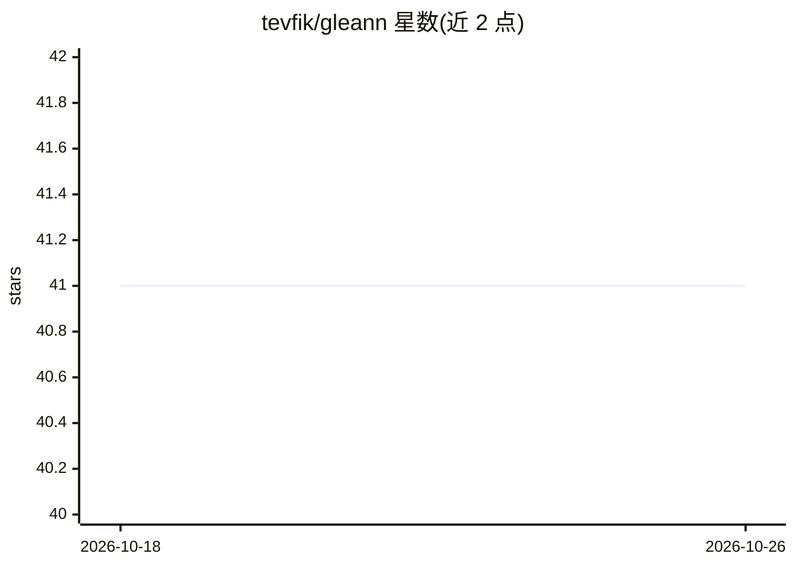

# tevfik/gleann

⭐ 41 · Go · MIT · 推送 2026-10-23 · [GitHub](https://github.com/tevfik/gleann) · 个人维护

**Go 编写的本地代码智能与 RAG 工作区，供 AI 编码代理接入**

以单一 Go 二进制（约 34MB）分发的本地 AI/RAG 工作区：用 Tree-sitter 做语法级分块并配合 KùzuDB 构建 AST 调用图，提供语义搜索、终端 RAG 问答（gleann ask/chat）、上游影响面分析，以及跨会话的分层长期记忆（短/中/长三级）。面向 AI 编码代理与终端用户，通过 `gleann install` 向 Claude Code、Cursor、Windsurf 等 17+ 平台自动注册 MCP 服务器；还提供表格感知文档分块、进程内 Docling BitNet VLM 处理扫描 PDF。零 Python 环境、零 Docker，全部本地运行。

## 筛选速览

| 维度 | 判定 | 备注 |
|---|---|---|
| AI 角色 | `ai-ecosystem` | LLM/agent 周边工具 |
| 许可风险 | `permissive` | MIT |
| 部署形态 | `library` | 以包/库形式分发 |
| 模型依赖 | local-ok | 支持本地模型 |
| 硬件要求 | — | 无带数字的原话,不猜 |
| 安装摩擦 | `low` | 无编译、无系统依赖或容器化 |
| 成熟度 | — | 结构信号不足 |

## 能力要点

- AST 调用图（KùzuDB）+ 向量检索的代码智能与 blast radius 分析
- 短/中/长三级跨会话持久记忆，自动注入提示词
- 一条命令向 17+ AI 平台注册 MCP 服务器配置
- 单一 Go 二进制（约 34MB），无需 Python 环境与 Docker

## 适用场景

- 给我的 AI 编码助手接上代码库语义检索与调用图上下文
- 在终端直接对代码库或文档做 RAG 问答
- 让编码代理拥有跨会话的长期记忆（约定、架构决策）
- 改代码前分析某个符号的上游影响面

## 场景标签

`RAG` `语义搜索` `Agent 记忆` · 领域:Agent 开发

## 证据(README 行号)

> L8: **High-performance local AI workspace, codebase intelligence, and persistent cross-session memory for AI coding agen
> L67: - **1-Click Setup**: Run `gleann install` to automatically register the Model Context Protocol (MCP) server across 

## 星数曲线

2026-10-18 41 → 2026-10-26 41（+0）

---
*卡片 v1 · prompt 1.4 · 生成 2026-10-25 · 置信度 high · 依据 README sha `9af5c8310aeb` · [字段定义](../../DATASET.md)*
