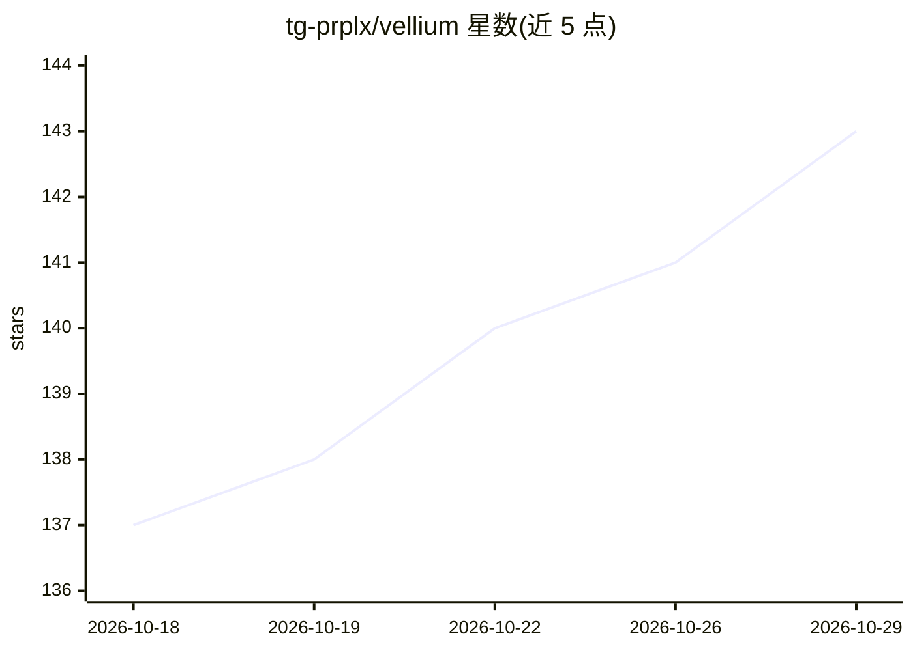

# tg-prplx/vellium

⭐ 143 · TypeScript · MIT · 推送 2026-10-17 · [GitHub](https://github.com/tg-prplx/vellium) · 个人维护 · 中文 README

**本地优先的桌面 AI 对话/角色扮演/长文写作工作台**

面向终端用户的 Electron 桌面应用，提供多角色对话、角色扮演（分支时间线、LoreBooks、场景状态）、长篇写作（项目/章节/场景、改写扩展）、RAG 知识库、实时语音与 Inochi2D 立绘、MCP 工具与本地插件。可连接 OpenAI 兼容 API、OpenRouter、LM Studio、Ollama、KoboldCpp 等多种端点，数据存储在本地 SQLite，支持 Full Local Mode 阻断公共端点。Agents 功能已弃用并默认禁用，保留于 Legacy 设置。界面提供英/俄/中/日四种翻译。

## 筛选速览

| 维度 | 判定 | 备注 |
|---|---|---|
| AI 角色 | `ai-native` | 本体是模型或模型工具 |
| 许可风险 | `permissive` | MIT |
| 部署形态 | `library` | 以包/库形式分发 |
| 模型依赖 | local-ok | 支持本地模型 |
| 硬件要求 | — | 无带数字的原话,不猜 |
| 安装摩擦 | `low` | 无编译、无系统依赖或容器化 |
| 成熟度 | — | 结构信号不足 |

## 能力要点

- 分支时间线多角色对话与 LoreBooks 世界书
- 写作项目、Character Forge、RAG 上下文绑定与 DOCX 导入导出
- 实时语音（Whisper 兼容 STT、流式 TTS）与 Inochi2D 立绘口型同步
- MCP 工具调用、本地插件与 SQLite 本地持久化

## 适用场景

- 在本地进行多角色 AI 角色扮演与对话
- 借助 RAG 知识库进行长篇写作
- 接入 Ollama/LM Studio 等本地模型实现完全离线使用

## 场景标签

`聊天机器人` `AI 写作` `RAG` · 领域:对话与助手

## 证据(README 行号)

> L10: Vellium is a local-first desktop workbench for AI chat, character roleplay, live
> L11: voice conversations, and long-form writing. It connects to OpenAI-compatible

## 星数曲线

2026-10-18 137 → 2026-10-29 143（+6）

---
*卡片 v1 · prompt 1.4 · 生成 2026-10-22 · 置信度 high · 依据 README sha `fae4be166a0f` · [字段定义](../../DATASET.md)*
