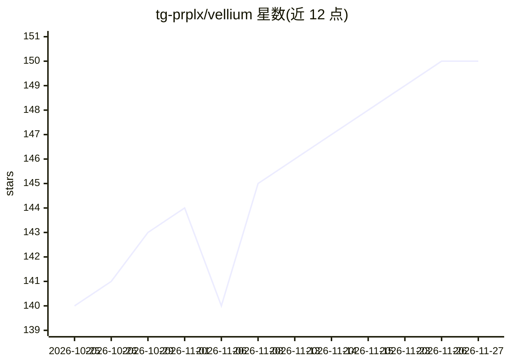

# tg-prplx/vellium

⭐ 150 · TypeScript · MIT · 推送 2026-11-21 · [GitHub](https://github.com/tg-prplx/vellium) · 个人维护 · 中文 README

**本地优先的桌面 AI 角色扮演、对话与长文写作工作台**

Vellium 是一个本地优先的桌面 AI 工作台，覆盖角色扮演聊天（分支时间线、多角色、LoreBooks、personas）、实时语音对话（Whisper 兼容 STT、流式 TTS、Inochi2D 口型/表情驱动）、长文写作（章节/场景、Character Forge、DOCX 导入导出）以及知识库 RAG 与 MCP 工具调用。连接 OpenAI 兼容 API、OpenRouter、Ollama、LM Studio、KoboldCpp 等端点，数据存于本地 SQLite。Agents 功能已弃用，仅在 Legacy 设置中保留兼容。

## 筛选速览

| 维度 | 判定 | 备注 |
|---|---|---|
| AI 角色 | `ai-native` | 本体是模型或模型工具 |
| 许可风险 | `permissive` | MIT |
| 部署形态 | `library` | 以包/库形式分发 |
| 模型依赖 | local-ok | 支持本地模型 |
| 硬件要求 | — | 无带数字的原话,不猜 |
| 安装摩擦 | `low` | 无编译、无系统依赖或容器化 |
| 成熟度 | — | 结构信号不足 |

## 能力要点

- 角色扮演聊天：分支时间线、多角色、LoreBooks、prompt blocks
- 实时语音：Whisper 兼容 STT、流式 TTS、Inochi2D 口型同步与情绪驱动
- 知识库 RAG：嵌入、可选重排序、Chat/Writing 显式绑定
- 本地优先：SQLite 持久化、Full Local Mode、权限门控插件

## 适用场景

- 与多个 AI 角色进行本地存储的角色扮演对话
- 带 RAG 上下文进行长篇写作与章节管理
- 通过 Ollama 或 LM Studio 使用本地模型进行语音对话
- 通过 MCP 工具扩展聊天能力

## 场景标签

`聊天机器人` `语音 Agent` `AI 写作` `RAG` · 领域:对话与助手

## 证据(README 行号)

> L10: Vellium is a local-first desktop workbench for AI chat, character roleplay, live
> L31: - **Chat and roleplay:** branching timelines, message editing, multiple

## 星数曲线

2026-10-25 140 → 2026-11-27 150（+10）

---
*卡片 v1 · prompt 1.4 · 生成 2026-11-27 · 置信度 high · 依据 README sha `1f470da1d48e` · [字段定义](../../DATASET.md)*
