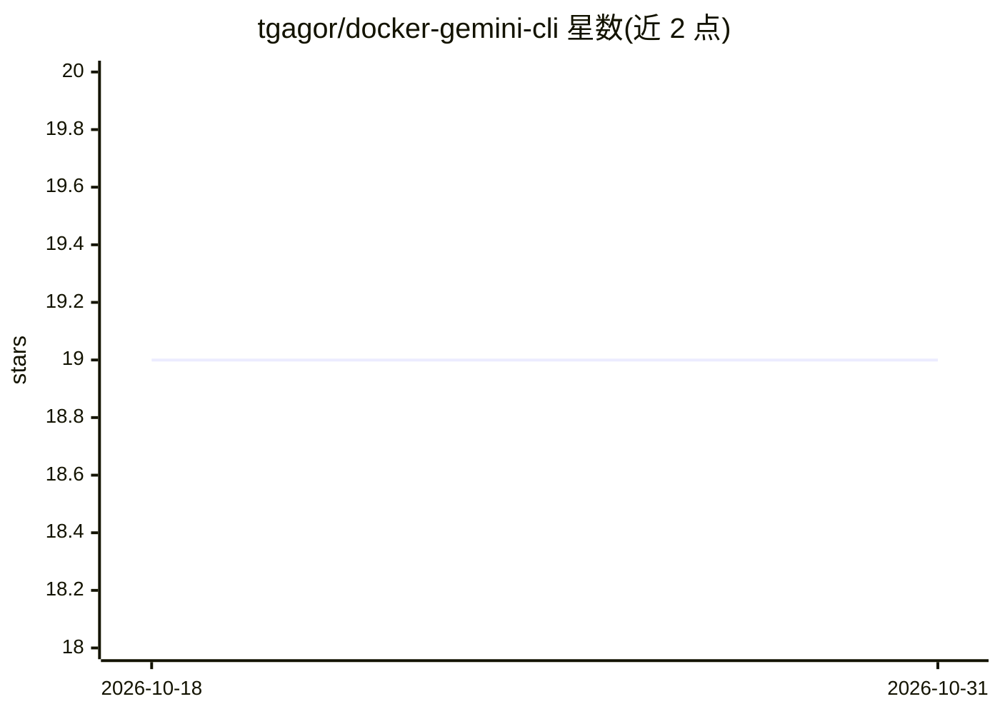

# tgagor/docker-gemini-cli

⭐ 19 · Dockerfile · GPL-2.0 · 推送 2026-10-01 · [GitHub](https://github.com/tgagor/docker-gemini-cli) · [官网](https://gagor.pro/2025/10/running-gemini-cli-in-a-docker-container/) · 个人维护

**将 Gemini CLI 封装为 Docker 镜像，免装 Node.js 即可运行**

把 Google Gemini CLI 打包为自动更新的 Docker 镜像，用户无需在本机安装 Node.js 及其依赖。推荐通过 shell 函数使用：挂载当前目录为工作区、挂载 ~/.gemini 保留配置、匹配 UID/GID 避免文件权限问题。提供 Node.js 默认变体（linux/amd64、arm64、arm/v7）与 Bun 变体（仅 amd64/arm64），并带 alpine 基础镜像标签；镜像自动做漏洞扫描。也可直接用 docker run 运行。

## 筛选速览

| 维度 | 判定 | 备注 |
|---|---|---|
| AI 角色 | `ai-ecosystem` | LLM/agent 周边工具 |
| 许可风险 | `viral` | GPL-2.0 |
| 部署形态 | `self-host` | docker 或自建部署 |
| 模型依赖 | — | README 未给出锁定关系 |
| 硬件要求 | — | 无带数字的原话,不猜 |
| 安装摩擦 | `low` | 无编译、无系统依赖或容器化 |
| 成熟度 | — | 结构信号不足 |

## 能力要点

- 自动更新的 Gemini CLI Docker 镜像，免装 Node.js
- 推荐 shell 函数封装：目录/配置挂载与 UID/GID 权限匹配
- Node.js 与 Bun 两种运行时变体，含 alpine 标签
- 镜像自动扫描漏洞

## 适用场景

- 不想在系统里安装 Node.js 又想用 Gemini CLI
- 在隔离容器中运行 Gemini CLI 保持环境干净
- 跨 amd64/arm64/armv7 设备运行同一 CLI 环境

## 场景标签

`编码 Agent` · 领域:编码与开发

## 证据(README 行号)

> L3: A convenient and isolated way to run the Gemini CLI without needing to install Node.js or its dependencies on your l
> L13: * Docker must be installed and running on your system.

## 星数曲线

2026-10-18 19 → 2026-10-31 19（+0）

---
*卡片 v1 · prompt 1.4 · 生成 2026-10-28 · 置信度 high · 依据 README sha `fd444cac78bf` · [字段定义](../../DATASET.md)*
