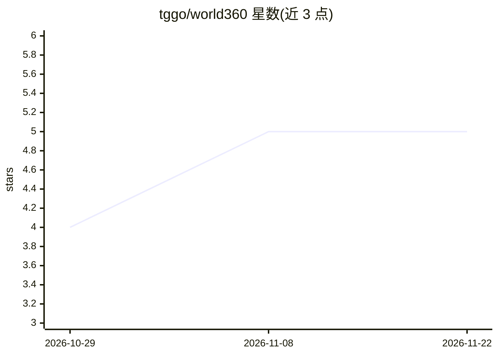

# tggo/world360

⭐ 5 · JavaScript · MIT · 推送 2026-10-13 · [GitHub](https://github.com/tggo/world360) · [官网](https://world360.ihatebot.com) · 个人维护

**把任意城市 OSM 数据绘成漫画风 3D 场景的工具**

基于 three.js 的 Web 应用：输入城市名或地址，从 OpenStreetMap 与 OpenFreeMap 瓦片构建 200 m–1 km 范围的 3D 街区，通过两次渲染通道与全屏着色器生成墨线、网点、实黑的漫画风格画面。支持步行/飞行视角、四季与阴影、PNG（最高 4800 px）与 GLB 导出。可选接入自建 ComfyUI 运行 Krea2 img2img，将画面重绘为漫画或条漫分镜。前端用 npm 运行，漫画渲染需额外部署 Go 编写的 API 服务。

## 筛选速览

| 维度 | 判定 | 备注 |
|---|---|---|
| AI 角色 | `ai-enhanced` | 去掉 AI 部分产品仍成立 |
| 许可风险 | `permissive` | MIT |
| 部署形态 | `library` | 以包/库形式分发 |
| 模型依赖 | — | README 未给出锁定关系 |
| 硬件要求 | — | 无带数字的原话,不猜 |
| 安装摩擦 | `low` | 无编译、无系统依赖或容器化 |
| 成熟度 | — | 结构信号不足 |

## 能力要点

- 从 OpenStreetMap/Overpass 生成带屋顶、电线杆等细节的程序化 3D 街区
- 着色器实现描边、网点与实黑的漫画渲染（四种画风模式）
- PNG（含透明背景与 OSM 署名）、GLB 与分享链接导出
- 可选经 ComfyUI 调用 Krea2 做 img2img 漫画重绘

## 适用场景

- 为漫画/条漫寻找并生成特定城市的背景分镜
- 导出 GLB 场景用于其他 3D 工作流
- 按地点与镜头参数生成可分享的漫画风街景图

## 场景标签

`图像生成` · 领域:内容生成

## 证据(README 行号)

> L3: Any place on Earth as a comic background. Type a city or address: World360 builds the streets in 3D from OpenStreetM
> L22: - **Comic render** (optional): the current frame is used as an img2img base for Krea2 on your own ComfyUI.

## 星数曲线

2026-10-29 4 → 2026-11-22 5（+1）

---
*卡片 v1 · prompt 1.4 · 生成 2026-11-21 · 置信度 high · 依据 README sha `8ffb8fd6cb6b` · [字段定义](../../DATASET.md)*
