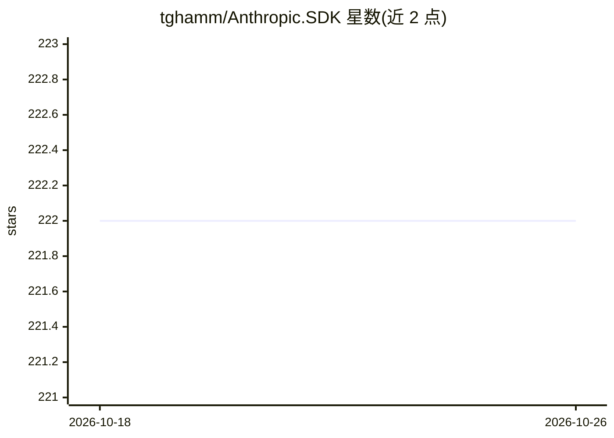

# tghamm/Anthropic.SDK

⭐ 222 · C# · MIT · 推送 2026-02-21 · [GitHub](https://github.com/tghamm/Anthropic.SDK) · [官网](https://www.nuget.org/packages/Anthropic.SDK) · 个人维护

**非官方 C#/.NET 客户端 SDK：在 .NET 应用中调用 Claude API**

由个人维护的非官方 Anthropic SDK，面向 .NET 开发者，目标框架为 NetStandard 2.0、.NET 8.0 与 .NET 10.0，通过 NuGet 安装。覆盖消息流式/非流式调用、扩展思考（含自适应与交错思考）、提示缓存、PDF/文档上传、引用（Citations）、MCP Connector 与客户端集成、Web Search/Web Fetch、批量 API、token 计数与模型列表等 API 能力，并内置基于 token 用量的成本估算工具。支持 Microsoft.Extensions.AI 的 IChatClient 接入与 Microsoft.SemanticKernel 消息客户端。API key 默认从 ANTHROPIC_API_KEY 环境变量读取，可注入自定义 HttpClient。

## 筛选速览

| 维度 | 判定 | 备注 |
|---|---|---|
| AI 角色 | `ai-ecosystem` | LLM/agent 周边工具 |
| 许可风险 | `permissive` | MIT |
| 部署形态 | `None` |  |
| 模型依赖 | locked-api |  |
| 硬件要求 | — | 无带数字的原话,不猜 |
| 安装摩擦 | `medium` | 含编译或系统依赖之一 |
| 成熟度 | — | 结构信号不足 |

## 能力要点

- 支持流式/非流式消息、扩展思考（adaptive/interleaved）与提示缓存
- 内置 MCP Connector 与客户端侧 MCP 集成（ModelContextProtocol SDK）
- 支持 Web Search、Web Fetch、Citations、PDF/文档上传与批量 API
- 内置请求成本估算与自定义/企业定价注册机制

## 适用场景

- 在 C#/.NET 应用中接入 Claude 对话与工具调用能力
- 通过 IChatClient 或 SemanticKernel 在 .NET 生态中使用 Claude
- 构建带 MCP 工具、网络搜索或批量推理的 .NET AI 应用

## 场景标签

 · 领域:LLM 基础设施/开发者 SDK

## 证据(README 行号)

> L5: Anthropic.SDK is an unofficial C# client designed for interacting with the Claude AI API. This powerful interface si
> L29: There are two ways to start using the `AnthropicClient`. The first is to simply new up an instance of the `Anthropi

## 星数曲线

2026-10-18 222 → 2026-10-26 222（+0）

---
*卡片 v1 · prompt 1.4 · 生成 2026-10-22 · 置信度 high · 依据 README sha `02ee393abc6d` · [字段定义](../../DATASET.md)*
