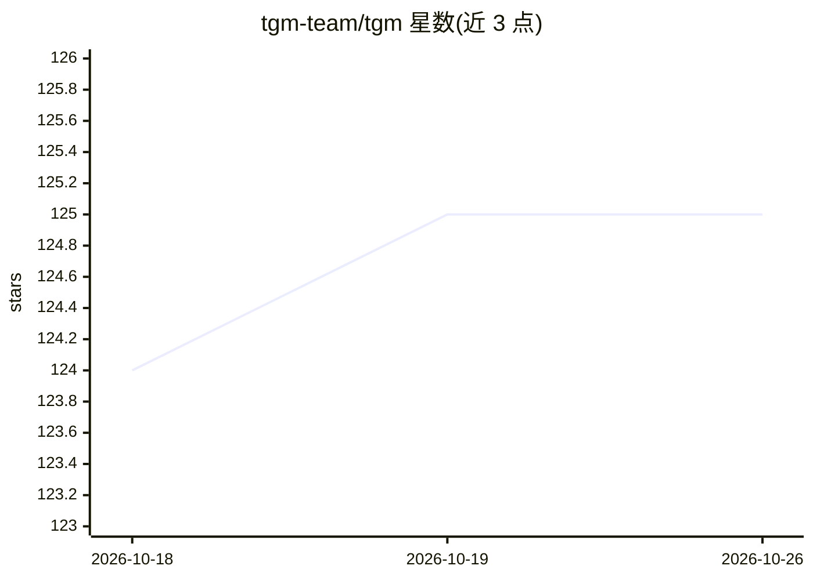

# tgm-team/tgm

⭐ 125 · Python · MIT · 推送 2026-09-22 · [GitHub](https://github.com/tgm-team/tgm) · [官网](https://tgm.readthedocs.io/en/latest/) · 组织维护

**时序图机器学习研究库：动态图上高效训练与原型开发**

面向时序图学习的研究库，为离散与连续时间动态图提供统一抽象，支持链接、节点与图级预测任务。采用三层架构：不可变时间排序图存储层、基于 DataLoader 与 HookManager 的执行层、直接在设备上物化批次的 ML 层。已实现 TGN、TGAT、GraphMixer、EdgeBank 等 12 种方法，内置 TGB 等数据集。处于 beta 阶段可能引入破坏性变更；Windows 未在 CI 中直接测试。以 pip 从源码或 PyPI 安装。

## 筛选速览

| 维度 | 判定 | 备注 |
|---|---|---|
| AI 角色 | `ai-native` | 本体是模型或模型工具 |
| 许可风险 | `permissive` | MIT |
| 部署形态 | `library` | 以包/库形式分发 |
| 模型依赖 | — | README 未给出锁定关系 |
| 硬件要求 | — | 无带数字的原话,不猜 |
| 安装摩擦 | `medium` | 含编译或系统依赖之一 |
| 成熟度 | `idea` | |

## 能力要点

- 离散与连续时间图的统一 API 与图离散化
- 已实现 EdgeBank、TGAT、TGN、DygFormer 等 12 种方法
- 三层架构：数据层/执行层/ML 层，Hook 框架标准化工作流
- 内置 TGB 等常用数据集与预置示例脚本

## 适用场景

- 在动态图上做链接/节点/图级预测的实验
- 快速原型验证新的时序图神经网络方法
- 使用预置脚本复现 TGAT 等基线结果

## 场景标签

`模型训练` · 领域:训练与推理

## 证据(README 行号)

> L16: TGM is a research library for temporal graph learning, designed to accelerate training on dynamic graphs while enab
> L17: It provides a unified abstraction for both discrete and continuous-time graphs, supporting diverse tasks across lin

## 星数曲线

2026-10-18 124 → 2026-10-26 125（+1）

---
*卡片 v1 · prompt 1.4 · 生成 2026-10-23 · 置信度 high · 依据 README sha `d5258f97991a` · [字段定义](../../DATASET.md)*
