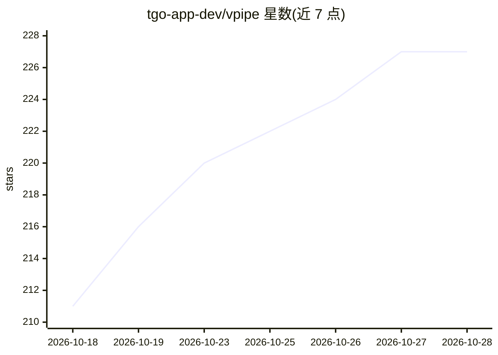

# tgo-app-dev/vpipe

⭐ 227 · C++ · Apache-2.0 · 推送 2026-10-27 · [GitHub](https://github.com/tgo-app-dev/vpipe) · 组织维护 · 中文 README

**Apple Silicon 上的本地多模态 AI 推理运行时与 macOS 应用**

面向 Apple Silicon Mac 的本地多模态 AI 运行时：将视频、音频、图像、文本与工具动作组织为可检视的 C++ 流水线图，生成模型前向通过自研 Metal 内核（metal-compute 后端）运行，不依赖 MPS/MLX/第三方张量运行时。支持 MiniMax H3 视频生成、Krea-2/FLUX 图像生成与编辑、Qwen 多模态聊天、实时 VQA、ASR/TTS 与本地工具调用；通过权重流送与 4-bit 量化使图像/视频生成可在 16 GB 机型上运行。提供签名公证的 macOS 应用（.dmg）与 Web UI，也可从源码构建（核心为可移植 C++20，模型栈需 Apple Silicon）。限制：设备端模型栈需 macOS 26+ 的 Apple Silicon Mac；模型体积大（如 MiniMax H3 下载约 115 GB）。

## 筛选速览

| 维度 | 判定 | 备注 |
|---|---|---|
| AI 角色 | `ai-native` | 本体是模型或模型工具 |
| 许可风险 | `permissive` | Apache-2.0 |
| 部署形态 | `desktop` | 安装包/桌面程序 |
| 模型依赖 | — | README 未给出锁定关系 |
| 硬件要求 | — | 无带数字的原话,不猜 |
| 安装摩擦 | `high` | 编译与系统依赖俱全 |
| 成熟度 | — | 结构信号不足 |

## 能力要点

- 自研 Metal 内核推理，无第三方张量运行时
- 权重流送与 4-bit 量化支持 16 GB 机型跑图像/视频生成
- 多模态流水线：图像编辑、视频生成、Qwen 聊天、实时 VQA、ASR/TTS、本地工具调用
- 可复现 Composer：保存布局、提示词、参数与模型配置

## 适用场景

- 在 Mac 上本地跑 MiniMax H3 视频与 Krea-2 图像生成
- 带图像输入的有状态本地聊天与实时视觉问答
- 构建包含检测、跟踪、音频标签的视频监控流水线
- 通过手机浏览器远程操控本机 AI 流水线

## 场景标签

`图像生成` `视频生成` `多模态` `语音识别` · 领域:内容生成

## 证据(README 行号)

> L5: - **Multimodal graph:** video, audio, images, text, and tool actions in one pipeline.
> L145: **What is VPIPE?** VPIPE is a local multimodal AI runtime for Apple Silicon
> L150: model forward pass runs through Metal kernels directly via its own

## 星数曲线

2026-10-18 211 → 2026-10-28 227（+16）

---
*卡片 v1 · prompt 1.4 · 生成 2026-10-22 · 置信度 high · 依据 README sha `98fbb2193847` · [字段定义](../../DATASET.md)*
