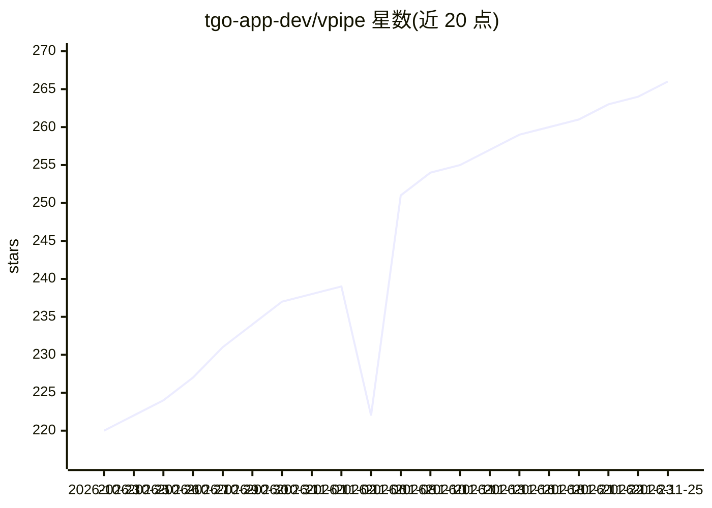

# tgo-app-dev/vpipe

⭐ 266 · C++ · Apache-2.0 · 推送 2026-11-23 · [GitHub](https://github.com/tgo-app-dev/vpipe) · 个人维护 · 中文 README

**Apple Silicon 上的本地多模态 AI 管线运行时与 Metal 推理**

面向 Apple Silicon Mac 的本地多模态 AI 运行时，用 C++20 与自研 Metal 内核实现模型前向计算，不依赖第三方张量运行时或 MPS/MLX；将模型、媒体流、用户输入与工具调用组织为可检查的管线图。支持 MiniMax H3、LTX-2.5 视频+音频生成，Krea-2、FLUX.2-klein 图像生成/编辑，Qwen/Ministral/DeepSeek 聊天与 VQA，以及 ASR/TTS 和本地工具调用；通过权重流式与 4-bit 量化在 16 GB 机型上运行大模型。提供 macOS 应用（dmg 安装包）与源码构建两条安装路径，网页 UI 可从手机浏览器远程访问。

## 筛选速览

| 维度 | 判定 | 备注 |
|---|---|---|
| AI 角色 | `ai-native` | 本体是模型或模型工具 |
| 许可风险 | `permissive` | Apache-2.0 |
| 部署形态 | `desktop` | 安装包/桌面程序 |
| 模型依赖 | locked-api |  |
| 硬件要求 | — | 无带数字的原话,不猜 |
| 安装摩擦 | `high` | 编译与系统依赖俱全 |
| 成熟度 | — | 结构信号不足 |

## 能力要点

- 自研 Metal 后端的生成模型前向计算，运行时小于 30 MB
- 权重流式 + 4-bit 模型准备，16 GB 基础款 Mac 可做图像/视频生成
- 视频、音频、图像、文本与工具调用合一的多模态管线图
- macOS 应用安装包与 C++20 源码构建两种分发方式

## 适用场景

- 在 Mac 本地做提示词驱动的图像编辑与文生图
- 本地生成带配乐的短视频（MiniMax H3 / LTX-2.5）
- 搭建实时 VQA、语音识别、本地聊天等多模态管线
- 通过 MCP 式本地工具阶段搭建本地 AI agent

## 场景标签

`图像生成` `视频生成` `语音合成` `多模态` · 领域:内容生成

## 证据(README 行号)

> L3: **Lightweight local multimodal AI pipelines and custom Metal inference for Apple Silicon Macs.**
> L146: **What is VPIPE?** VPIPE is a local multimodal AI runtime for Apple Silicon
> L150: **Does VPIPE use MPS, MLX, or Python for inference?** No. VPIPE's generative

## 星数曲线

2026-10-23 220 → 2026-11-25 266（+46）

---
*卡片 v1 · prompt 1.4 · 生成 2026-11-25 · 置信度 high · 依据 README sha `bf8fdf757e6d` · [字段定义](../../DATASET.md)*
