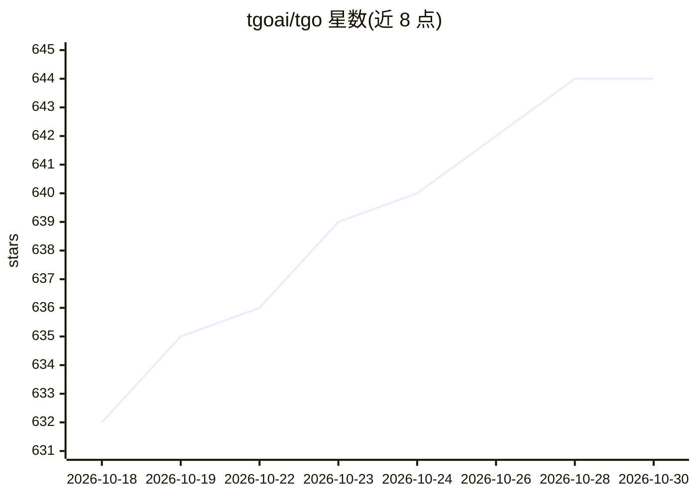

# tgoai/tgo

⭐ 644 · TypeScript · NOASSERTION · 推送 2026-04-28 · [GitHub](https://github.com/tgoai/tgo) · [官网](https://tgo.ai) · 组织维护 · 中文 README

**开源 AI Agent 客服平台：构建多渠道智能客服团队**

面向企业的开源 AI 客服平台，集成多渠道接入、Agent 编排、RAG 知识库与人工客服协作。支持多模型接入（OpenAI、Anthropic 等）、MCP 工具集成（含 40+ 内置工具的 CLI/MCP Server）、网站/微信等多渠道统一管理、智能转人工与访客管理。由 12 个服务仓库组成（FastAPI/React/Go 等），提供一键部署脚本与 Docker Compose 本地开发环境，另有 JS/iOS/Flutter/小程序 Widget SDK。要求 4 核 CPU、8GiB 内存。

## 筛选速览

| 维度 | 判定 | 备注 |
|---|---|---|
| AI 角色 | `ai-ecosystem` | LLM/agent 周边工具 |
| 许可风险 | `none` | NOASSERTION |
| 部署形态 | `self-host` | docker 或自建部署 |
| 模型依赖 | — | README 未给出锁定关系 |
| 硬件要求 | — | 无带数字的原话,不猜 |
| 安装摩擦 | `low` | 无编译、无系统依赖或容器化 |
| 成熟度 | — | 结构信号不足 |

## 能力要点

- 多 Agent 编排与多模型接入（OpenAI、Anthropic 等），SSE 流式响应
- RAG 知识库：文档/问答/网站爬取三种来源与向量语义检索
- MCP 工具商店、自定义工具与 OpenAPI Schema 自动生成表单
- 多渠道接入（Web/微信公众号/小程序等）与智能转人工协作

## 适用场景

- 企业搭建带知识库的 AI 客服系统
- 统一管理多渠道客服会话并按需转人工
- 为网站/App/小程序嵌入客服聊天组件

## 场景标签

`多智能体` `聊天机器人` `RAG` · 领域:Agent 开发

## 证据(README 行号)

> L9: TGO is an open-source AI agent customer service platform dedicated to helping enterprises "Build AI Agent Teams for 
> L46: ### 🤖 AI Agent Orchestration
> L52: ### 📚 Knowledge Base (RAG)

## 星数曲线

2026-10-18 632 → 2026-10-30 644（+12）

---
*卡片 v1 · prompt 1.4 · 生成 2026-10-21 · 置信度 high · 依据 README sha `9e459b357ca5` · [字段定义](../../DATASET.md)*
