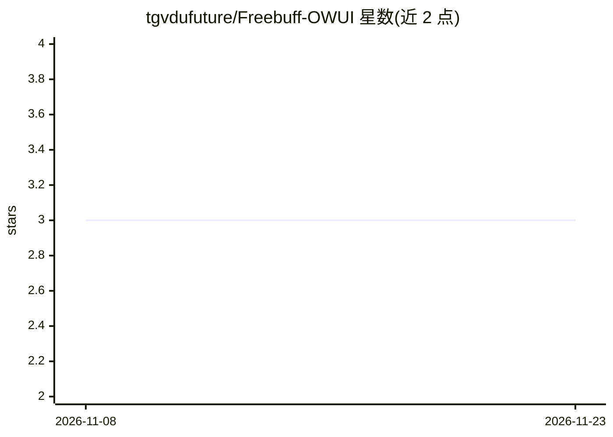

# tgvdufuture/Freebuff-OWUI

⭐ 3 · TypeScript · AGPL-3.0 · 推送 2026-11-04 · [GitHub](https://github.com/tgvdufuture/Freebuff-OWUI) · 个人维护

**本地桥接：让 OpenWebUI 通过 OpenAI 兼容端点驱动 Freebuff CLI**

在 Freebuff CLI 与 OpenWebUI 之间运行的本地桥接程序：对外暴露 OpenAI 兼容的 /v1 端点，OpenWebUI 将其配置为后端连接；桥接在 PTY 中驱动 CLI，读取其写入磁盘的 transcript、log 与 turn state，在 OpenWebUI 中渲染推理折叠、工具调用、问题卡片与配额条，并支持历史会话导入、/recover、/import 与停止运行中的 turn。单用户本地工具，非托管服务；仅支持 Windows + Git Bash，CLI 更新可能破坏解析。

## 筛选速览

| 维度 | 判定 | 备注 |
|---|---|---|
| AI 角色 | `ai-ecosystem` | LLM/agent 周边工具 |
| 许可风险 | `viral` | AGPL-3.0 |
| 部署形态 | `desktop` | 安装包/桌面程序 |
| 模型依赖 | — | README 未给出锁定关系 |
| 硬件要求 | — | 无带数字的原话,不猜 |
| 安装摩擦 | `low` | 无编译、无系统依赖或容器化 |
| 成熟度 | — | 结构信号不足 |

## 能力要点

- 对外提供 OpenAI 兼容 /v1 端点，OpenWebUI 经 Settings → Connections 接入
- 在 PTY 中驱动 Freebuff CLI，解析 TUI 屏幕、chat-messages.json、log.jsonl 与 run-state.json
- 配额条、profile 切换、项目选择器、历史会话导入与崩溃恢复
- 对安装的 OpenWebUI 应用三个幂等补丁（复选卡片、文件夹排序、项目选择按钮）

## 适用场景

- 在 OpenWebUI 界面中使用本机 Freebuff CLI 账户的会话与配额
- 把 CLI 的历史对话导入 OpenWebUI 并按项目整理
- 本地单机管理多个 Freebuff profile 的会话与配额

## 场景标签

`模型网关` · 领域:Agent 开发

## 证据(README 行号)

> L3: A **local** bridge between the Freebuff CLI and OpenWebUI: OpenWebUI talks to the
> L4: CLI as if it were an OpenAI backend, with no provider API in between.
> L185: src/freebuff/   driving the CLI: PTY, screen, transcript, quota, import

## 星数曲线

2026-11-08 3 → 2026-11-23 3（+0）

---
*卡片 v1 · prompt 1.4 · 生成 2026-11-21 · 置信度 high · 依据 README sha `84fe6226a2b1` · [字段定义](../../DATASET.md)*
