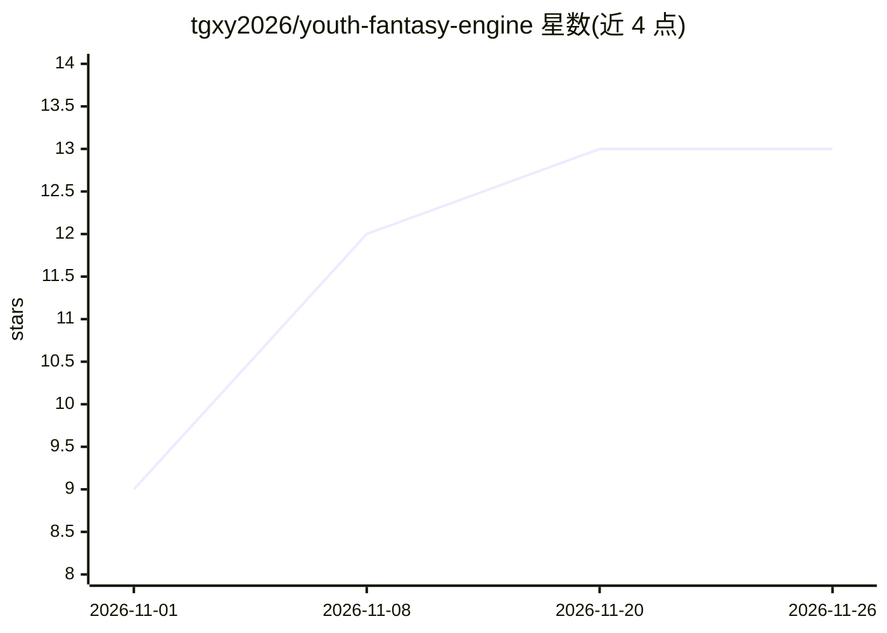

# tgxy2026/youth-fantasy-engine

⭐ 13 · TypeScript · MIT · 推送 2026-11-25 · [GitHub](https://github.com/tgxy2026/youth-fantasy-engine) · [官网](https://youth-fantasy-engine.online) · 个人维护 · 中文 README

**网文作者的结构化长篇创作工作台，内置 AI 辅助续写与推演**

面向长篇小说作者的本地优先创作工作台，把世界观、角色、大纲、正文收进同一数据结构：56 个页签覆盖角色卡、人物关系、伏笔追踪、时间脉络、情节推演等。AI 部分定位「辅助不是代笔」：一键续写、整章改写、拆书、酒馆模式角色扮演推演，上下文按预算裁剪并带防剧透与保密等级过滤。提供 Windows 桌面安装版、便携版与网页版三种形态，桌面版可经 ACP 接入外部 Agent。作者声明项目由 AI 辅助开发，且不建议用 AI 大规模生成正文。

## 筛选速览

| 维度 | 判定 | 备注 |
|---|---|---|
| AI 角色 | `ai-enhanced` | 去掉 AI 部分产品仍成立 |
| 许可风险 | `permissive` | MIT |
| 部署形态 | `desktop` | 安装包/桌面程序 |
| 模型依赖 | local-ok | 支持本地模型 |
| 硬件要求 | — | 无带数字的原话,不猜 |
| 安装摩擦 | `low` | 无编译、无系统依赖或容器化 |
| 成熟度 | — | 结构信号不足 |

## 能力要点

- 10 板块 56 页签：角色/关系双轨、伏笔追踪、时间脉络、从总纲到细纲的链路
- AI 入口带上下文预算、保密等级与防剧透过滤，提示词全部开放可改
- 模型支持 Ollama、OpenAI/Anthropic/Gemini 官方协议及多家国内云端服务
- 三种形态分发：桌面安装版、便携版（需 Node.js）、浏览器网页版

## 适用场景

- 管理长篇小说的世界观、角色关系与伏笔，避免设定前后矛盾
- 写作卡壳时用 AI 推演分歧点走向或让 AI 扮演角色验人设
- 把参考书目拆解成自己的素材库
- 多设备间同步并续写同一本书稿

## 场景标签

`AI 写作` `知识库管理` · 领域:内容生成

## 证据(README 行号)

> L47: 它**不是「AI 帮你写小说」**，而是 —— **把你散落在各个文档里的创作资产，收进一个有结构、能互相关联、能按需喂给 AI 的工作台。**
> L29: 软件内置了一整套 AI 能力：一键续写、整章改写、一键拆书、创意写作、角色扮演推演……但设计这些功能的**本意是辅助创作** —— 帮你把设定理顺、把大纲排好、在卡壳的地方推一把，让你写得更顺，而不是替你写。
> L259: |模型调用|OpenAI 兼容 / OpenAI Responses / Anthropic Messages / Gemini generateContent / Ollama 原生，SSE 流式输出；桌面版另有 ACP（Ag

## 星数曲线

2026-11-01 9 → 2026-11-26 13（+4）

---
*卡片 v1 · prompt 1.4 · 生成 2026-11-18 · 置信度 mid · 依据 README sha `bf4ae61bafae` · [字段定义](../../DATASET.md)*
