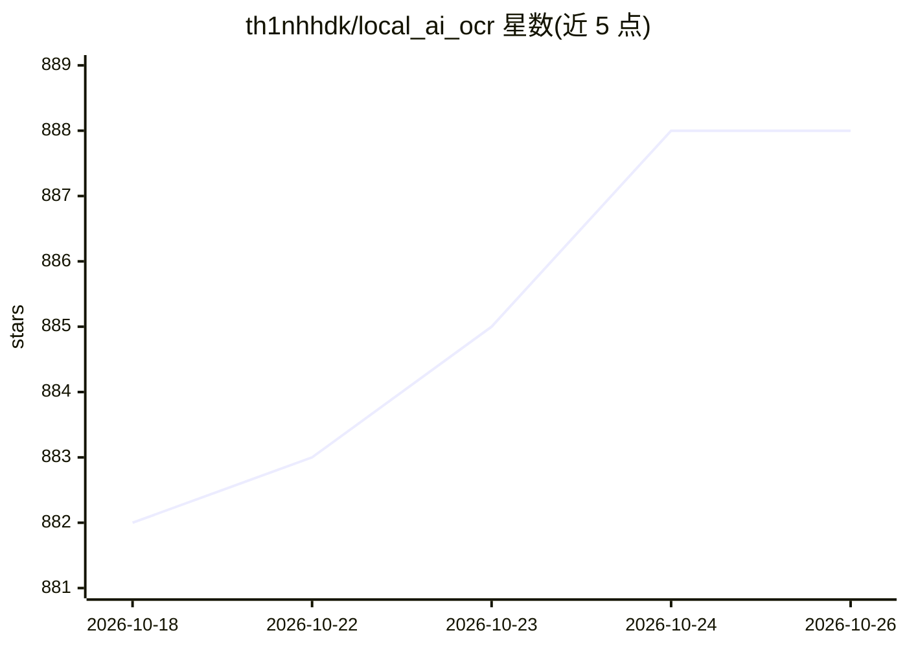

# th1nhhdk/local_ai_ocr

⭐ 888 · Python · Apache-2.0 · 推送 2026-07-05 · [GitHub](https://github.com/th1nhhdk/local_ai_ocr) · 个人维护 · 中文 README

**本地离线 OCR 软件：用 DeepSeek-OCR-2 识别图片与 PDF**

基于 DeepSeek-OCR-2 模型的本地 OCR 桌面软件，初始设置后完全离线运行，支持多语言（越南语/英语/中文/日语等）识别图片（png/jpg/webp/heic 等）与 PDF（可选页范围），提供三种处理模式（Markdown 保持格式、Free OCR、标准 OCR），可提取文档内图片并插入结果，支持格式化结果复制到 Word 及直接导出 .docx。自动检测 GPU 加速（推荐 Nvidia 8GB VRAM），无 GPU 时回退 CPU。软件包约需 11GB 磁盘与 16GB 内存，Windows 10+/Linux 可运行。

## 筛选速览

| 维度 | 判定 | 备注 |
|---|---|---|
| AI 角色 | `ai-native` | 本体是模型或模型工具 |
| 许可风险 | `permissive` | Apache-2.0 |
| 部署形态 | `None` |  |
| 模型依赖 | locked-api |  |
| 硬件要求 | `gpu-8g` | |
| 安装摩擦 | `low` | 无编译、无系统依赖或容器化 |
| 成熟度 | — | 结构信号不足 |

## 能力要点

- 初始设置后完全离线运行，数据不出本机
- 支持 png/jpg/webp/heic 图片与多页 PDF（可选页范围）批量队列处理
- 三种 OCR 模式，保持表格等排版并可导出 .docx
- GPU 自动检测加速，无 GPU 可用 CPU 回退模式运行

## 适用场景

- 离线把扫描件或 PDF 转成可编辑的 Word 文档
- 在无网络或数据敏感环境下做多语言文字识别
- 批量排队处理多个图片/PDF 文件并保留排版

## 场景标签

`OCR` · 领域:感知与多模态

## 证据(README 行号)

> L7: Một phần mềm OCR **nội bộ**, **offline** (sau khi thiết lập lần đầu), **portable**, có thể xử lý ảnh và tệp PDF, sử 
> L13: - **Chạy offline (nội bộ):** **Không cần kết nối mạng, cũng chả liên lạc đi đâu**, đảm bảo bảo mật dữ liệu tuyệt đố
> L52: - Mặc dù `DeepSeek-OCR-2` có độ chính xác cực cao, bạn **vẫn nên kiểm tra lại kết quả**, đặc biệt với tài liệu quan

## 星数曲线

2026-10-18 882 → 2026-10-26 888（+6）

---
*卡片 v1 · prompt 1.4 · 生成 2026-10-21 · 置信度 high · 依据 README sha `c06f7b1b7d32` · [字段定义](../../DATASET.md)*
