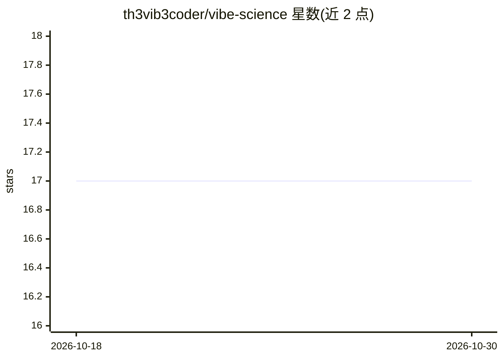

# th3vib3coder/vibe-science

⭐ 17 · JavaScript · Apache-2.0 · 推送 2026-08-19 · [GitHub](https://github.com/th3vib3coder/vibe-science) · 个人维护

**面向 Claude Code 的科研完整性运行时：对抗式审查与质量门**

Vibe Science 是构建在 Claude Code 之上的研究运行时插件系统，分三层：CLAUDE.md 宪法层（12 条不变法则）、skills/vibe 方法论层（OTAE 循环、Reviewer 2 对抗式审查协议）、plugin 执行层（7 个生命周期钩子、SQLite 持久化、门控引擎）。运行时强制执行 DQ4、L-1+、L0、D1 与停止时检查等核心门控，提供 DOI/PMID/arXiv 引用验证、FTS5/BM25 检索与跨会话上下文恢复。限制：并非所有方法论规则均在插件层硬性强制，部分仍依赖技能/审查层纪律。配套 ACM EASE '26 VibeX 论文。

## 筛选速览

| 维度 | 判定 | 备注 |
|---|---|---|
| AI 角色 | `ai-ecosystem` | LLM/agent 周边工具 |
| 许可风险 | `permissive` | Apache-2.0 |
| 部署形态 | `library` | 以包/库形式分发 |
| 模型依赖 | — | README 未给出锁定关系 |
| 硬件要求 | — | 无带数字的原话,不猜 |
| 安装摩擦 | `medium` | 含编译或系统依赖之一 |
| 成熟度 | `idea` | |

## 能力要点

- 7 个 Claude Code 生命周期钩子与 SQLite 跨会话持久化
- 32 个质量门控中 8 个 schema 强制，核心 DQ4/L-1+/L0/D1 硬性执行
- DOI/PMID/arXiv 引用自动抽取与有界验证
- Reviewer 2 对抗式审查协议与种子故障注入（SFI）

## 适用场景

- 在 Claude Code 中进行需可审计的 AI 辅助科研
- 阻止未经文献检索、引用未验证或未审查的声明推进
- 跨会话保留研究状态与结构化审计轨迹

## 场景标签

`科研工具` · 领域:学习与行业

## 证据(README 行号)

> L26: > Integrity-first research runtime for Claude Code. Plugin-enforced checks, adversarial review, confounder discipli
> L151: - **Enforcement layer**: the plugin in `plugin/`, which persists state and structurally enforces selected checks i
> L184: The plugin wraps part of the skill in **code-level enforcement and persistence**: 7 lifecycle hooks, a gate engine

## 星数曲线

2026-10-18 17 → 2026-10-30 17（+0）

---
*卡片 v1 · prompt 1.4 · 生成 2026-10-29 · 置信度 high · 依据 README sha `b0eae5a6fb2c` · [字段定义](../../DATASET.md)*
