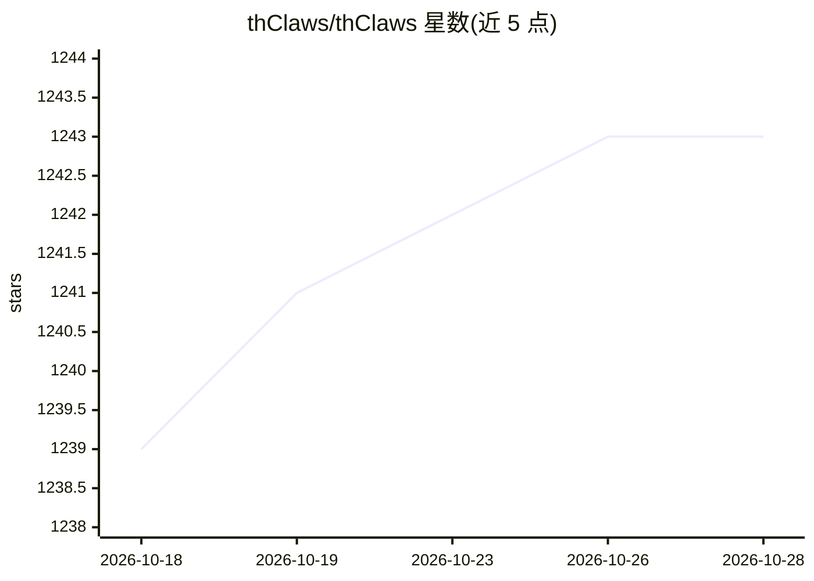

# thClaws/thClaws

⭐ 1,243 · Rust · Apache-2.0 · 推送 2026-10-25 · [GitHub](https://github.com/thClaws/thClaws) · [官网](https://thclaws.ai) · 组织维护

**Rust 编写的开源 AI agent 工作台：单二进制提供 GUI/CLI/Webapp**

用原生 Rust 实现的 AI agent 工作环境，同一二进制运行桌面 GUI、CLI REPL、非交互模式与 Webapp（含 OpenAI/Anthropic 兼容 API）。支持 27 个提供商共 1,100+ 模型，兼容 MCP、SKILL.md 技能与插件扩展。提供三档 agent 编排（子 agent、并发旁路、多进程 Agent Teams）、每 agent 独立隔离与 OS 级 Bash 沙箱、KMS 知识库、定时任务、PDF/DOCX 等文档工具与 Media Studio 图像/视频生成。由 ThaiGPT Co., Ltd. 团队开发，MIT OR Apache-2.0 双许可。

## 筛选速览

| 维度 | 判定 | 备注 |
|---|---|---|
| AI 角色 | `ai-ecosystem` | LLM/agent 周边工具 |
| 许可风险 | `permissive` | Apache-2.0 |
| 部署形态 | `desktop` | 安装包/桌面程序 |
| 模型依赖 | local-ok | 支持本地模型 |
| 硬件要求 | — | 无带数字的原话,不猜 |
| 安装摩擦 | `low` | 无编译、无系统依赖或容器化 |
| 成熟度 | — | 结构信号不足 |

## 能力要点

- 单二进制四种形态：桌面 GUI、CLI、headless、Webapp（OpenAI/Anthropic 兼容 API）
- 27 提供商、1,100+ 模型，会话中 /model /provider 切换，支持 Ollama 本地离线运行
- 多 agent 工作区：最多 8 个 agent 并行，各自独立会话/知识库/沙箱，崩溃自动重启
- OS 级 shell 沙箱（Seatbelt/Landlock/bubblewrap）与 MCP、技能、插件、hooks 扩展

## 适用场景

- 在本地终端或桌面用 AI agent 进行编码与自动化任务
- 让多个 agent 并行协作完成研究、写作与构建工作
- 通过 Webapp 把 agent 暴露为 OpenAI/Anthropic 兼容接口供其他工具调用
- 完全离线使用本地 Ollama 模型运行 agent

## 场景标签

`模型网关` `多智能体` `编码 Agent` `视频生成` · 领域:Agent 开发

## 证据(README 行号)

> L5: A native-Rust AI agent workspace that codes, automates, remembers, and coordinates — running on your own machine. On
> L104: - **Webapp** (`thclaws --serve --port 7878`) — same engine over WebSocket/HTTP, plus a drop-in API surface so othe
> L110: - **Multi-provider** — Anthropic (native + Claude Agent SDK via Claude Code auth), OpenAI (Chat Completions + Resp

## 星数曲线

2026-10-18 1,239 → 2026-10-28 1,243（+4）

---
*卡片 v1 · prompt 1.4 · 生成 2026-10-21 · 置信度 high · 依据 README sha `5ae26a2becc6` · [字段定义](../../DATASET.md)*
