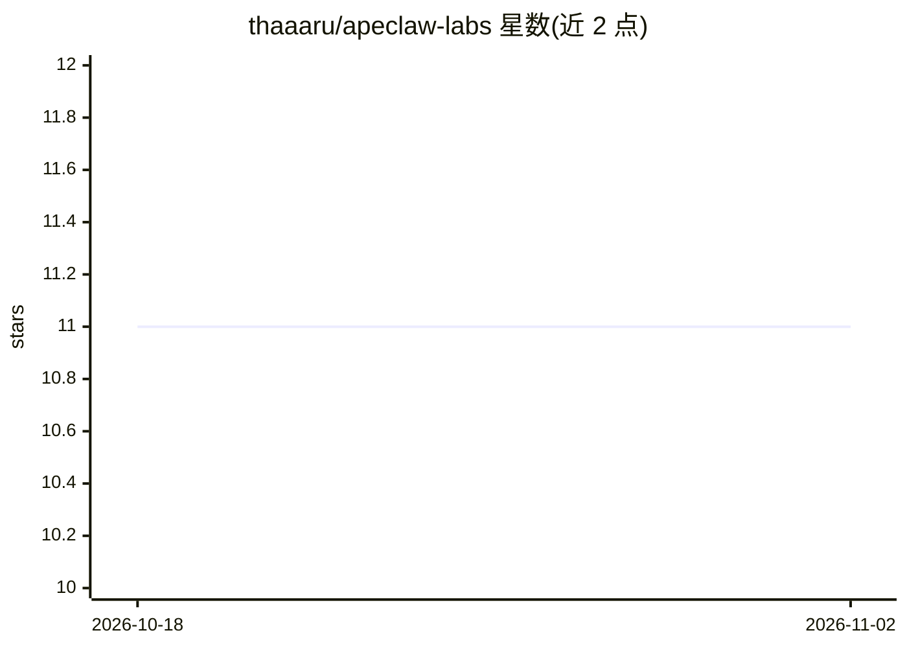

# thaaaru/apeclaw-labs

⭐ 11 · Rust · Apache-2.0 · 推送 2026-04-05 · [GitHub](https://github.com/thaaaru/apeclaw-labs) · 个人维护

**面向斯里兰卡生态的 Rust 本地 AI Agent 运行时框架**

ApeClaw 是 ZeroClaw 的一个分支，定位为面向斯里兰卡数字生态系统的全本地 agentic AI 助手，用 100% Rust 编写，无 Python/Node/云依赖。支持 Anthropic、OpenAI、Ollama、Gemini、OpenRouter、GLM、ZAI 七种 AI 提供方，以及 Telegram、Discord、Slack 等 8 种消息通道。内置 CBSL 汇率与 CSE 市场数据的本地工具（支持僧伽罗语/泰米尔语 Unicode）、SQLite 持久化记忆、ISO 27001 A.12.4 审计日志与 GPIO/串口硬件集成。约 5 MB 二进制、空闲内存 <5 MB，可在树莓派 Zero 2W 上运行。通过 cargo 源码安装。

## 筛选速览

| 维度 | 判定 | 备注 |
|---|---|---|
| AI 角色 | `ai-ecosystem` | LLM/agent 周边工具 |
| 许可风险 | `permissive` | Apache-2.0 |
| 部署形态 | `library` | 以包/库形式分发 |
| 模型依赖 | local-ok | 支持本地模型 |
| 硬件要求 | — | 无带数字的原话,不猜 |
| 安装摩擦 | `medium` | 含编译或系统依赖之一 |
| 成熟度 | — | 结构信号不足 |

## 能力要点

- 100% Rust 实现，~5 MB 二进制，空闲内存 <5 MB，可跑在树莓派 Zero 2W
- 7 种 AI 提供方（Anthropic/OpenAI/Ollama/Gemini/OpenRouter/GLM/ZAI）与 8 种消息通道
- 斯里兰卡本地工具：CBSL LKR 汇率、CSE 市场数据，原生僧伽罗语/泰米尔语 Unicode
- 每次工具调用写入本地审计日志（ISO 27001 A.12.4），AES-256-GCM 密钥存储

## 适用场景

- 在本地硬件上部署数据不出境的 AI agent 助手
- 通过 Telegram/Discord 等多通道运行个人 AI 助手
- 在树莓派等边缘设备上运行轻量 agent
- 查询斯里兰卡汇率与股市数据的对话式助理

## 场景标签

`Agent 框架` `AI 助手` · 领域:Agent 开发

## 证据(README 行号)

> L13: ApeClaw is a fork of ZeroClaw specialized for the Sri Lankan
> L25: |**AI providers**|Anthropic, OpenAI, Ollama, Gemini, OpenRouter, GLM, ZAI|
> L37: cargo install --path .

## 星数曲线

2026-10-18 11 → 2026-11-02 11（+0）

---
*卡片 v1 · prompt 1.4 · 生成 2026-11-01 · 置信度 high · 依据 README sha `6b6017ea6696` · [字段定义](../../DATASET.md)*
