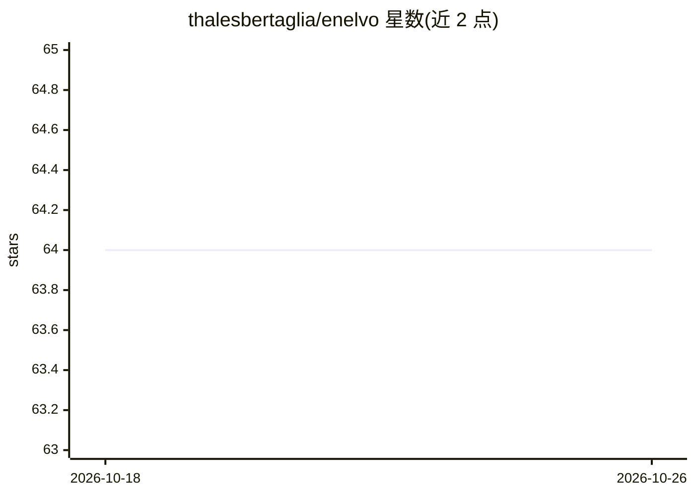

# thalesbertaglia/enelvo

⭐ 64 · Python · MIT · 推送 2026-10-23 · [GitHub](https://github.com/thalesbertaglia/enelvo) · [官网](http://thalesbertaglia.com/enelvo) · 个人维护

**葡萄牙语用户生成内容的文本规范化工具**

面向葡萄牙语文本（推文、博客、商品评论等）的噪声词规范化工具，识别并规范化拼写错误、网络俚语、缩写、专有名词等。由硕士项目发展而来，基于词嵌入的无监督规范化方法（WNUT 2016 论文）。提供 CLI 与 Python API 两种用法：CLI 支持文件/目录批处理、交互模式、自定义词典、忽略/强制列表、实体大写化与标点清理等参数；API 层面可通过 Normaliser 类自定义候选生成与打分指标。限制：仅支持葡萄牙语，依赖语言词典（README 自述词典不完美）。

## 筛选速览

| 维度 | 判定 | 备注 |
|---|---|---|
| AI 角色 | `ai-native` | 本体是模型或模型工具 |
| 许可风险 | `permissive` | MIT |
| 部署形态 | `library` | 以包/库形式分发 |
| 模型依赖 | — | README 未给出锁定关系 |
| 硬件要求 | — | 无带数字的原话,不猜 |
| 安装摩擦 | `low` | 无编译、无系统依赖或容器化 |
| 成熟度 | — | 结构信号不足 |

## 能力要点

- 识别并规范化拼写错误、俚语、缩写等噪声词
- 可替换语言词典与 ignore/force 列表定制行为
- 交互模式实时规范化，支持目录批处理
- 可作 Python 库使用，支持自定义打分指标

## 适用场景

- 清洗社交媒体文本以便做下游 NLP 处理
- 规范化葡萄牙语评论或博客语料
- 交互式逐句测试规范化效果

## 场景标签

 · 领域:NLP/文本预处理

## 证据(README 行号)

> L9: Enelvo is a tool for normalising noisy words in user-generated content written in Portuguese -- such as tweets, blog
> L11: The tool was developed as part of my master's project. You can find more details about how it works in my dissertat

## 星数曲线

2026-10-18 64 → 2026-10-26 64（+0）

---
*卡片 v1 · prompt 1.4 · 生成 2026-10-24 · 置信度 high · 依据 README sha `7fe22e3cd42f` · [字段定义](../../DATASET.md)*
