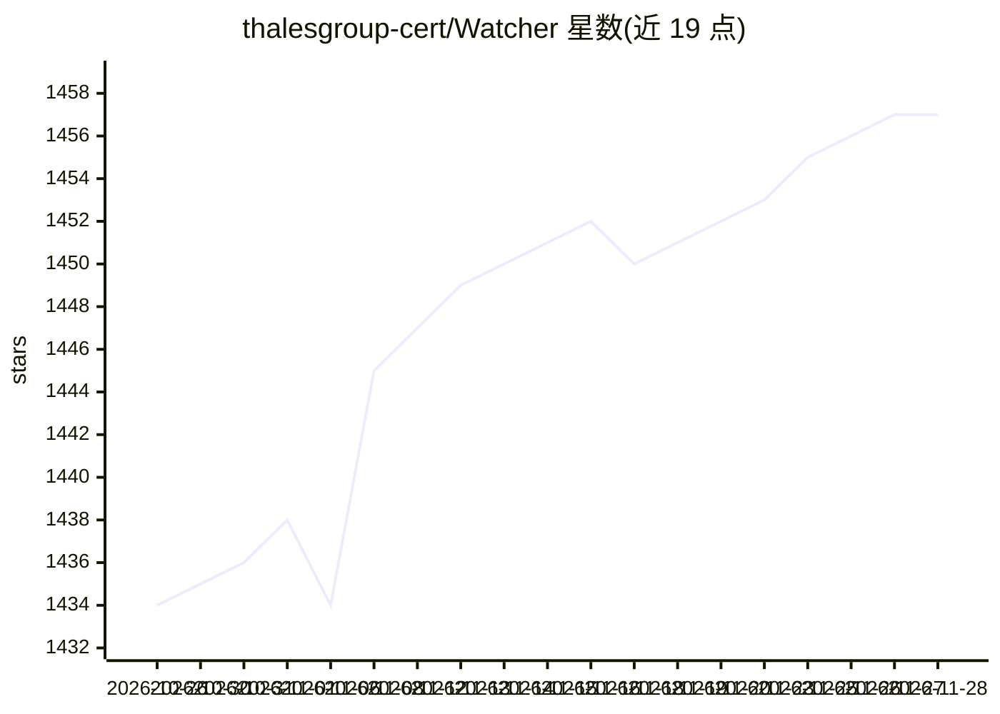

# thalesgroup-cert/Watcher

⭐ 1,457 · JavaScript · AGPL-3.0 · 推送 2026-11-27 · [GitHub](https://github.com/thalesgroup-cert/Watcher) · [官网](https://thalesgroup-cert.github.io/Watcher/) · 组织维护

**面向安全运营团队的 AI 威胁情报监测与猎杀平台**

基于 Django 与 React JS 的网络安全威胁发现与监测平台，部署于 Web 服务器或通过 Docker 运行。功能涵盖 AI 威胁情报周报与实时突发新闻摘要（支持自定义 LLM 并自动回退本地模型）、CVE 与勒索软件情报聚合、CERT 公告 RSS 监测、合法域名管理、信息泄露监测、恶意域名监控（TLSH 模糊哈希、RDAP/WHOIS）、基于 dnstwist 与 certstream 的可疑域名检测，并集成 TheHive、MISP、SSO/OIDC、Slack 通知与 Swagger API 文档。

## 筛选速览

| 维度 | 判定 | 备注 |
|---|---|---|
| AI 角色 | `ai-native` | 本体是模型或模型工具 |
| 许可风险 | `viral` | AGPL-3.0 |
| 部署形态 | `self-host` | docker 或自建部署 |
| 模型依赖 | local-ok | 支持本地模型 |
| 硬件要求 | — | 无带数字的原话,不猜 |
| 安装摩擦 | `low` | 无编译、无系统依赖或容器化 |
| 成熟度 | — | 结构信号不足 |

## 能力要点

- AI 周报聚类高危威胁，支持 OpenAI/Anthropic/Gemini/Ollama 等 LiteLLM 端点，无可用 LLM 时自动回退本地模型（dslim/bert-base-NER 做 IOC 实体抽取）
- 持续聚合 cve.circl.lu、ransomware.live、ransomlook.io 的 CVE 与勒索软件数据，按关键词 Watch Rules 匹配告警
- certstream 证书透明度实时监测 + dnstwist 域名变体检测识别可疑新注册域名
- TheHive 全同步与 MISP IOC 导出，支持 SMTP/Slack/Citadel 通知与 OIDC 单点登录

## 适用场景

- 持续监测针对本组织的 typosquatting 与可疑新注册域名
- 聚合多源 CVE、勒索软件受害者与 CERT 公告生成每周威胁报告
- 监测 Pastebin/GitHub 等平台上的凭据与 API key 泄露
- 将发现的 IOC 导出到 MISP 或同步到 TheHive 做事件响应

## 场景标签

`网络安全` · 领域:学习与行业

## 证据(README 行号)

> L31: Watcher is a Django & React JS platform designed to discover and monitor emerging cybersecurity threats with **AI-p
> L37: - **AI-Driven Threat Intelligence** - Transform raw threat data into actionable intelligence with the LLM of your c

## 星数曲线

2026-10-26 1,434 → 2026-11-28 1,457（+23）

---
*卡片 v1 · prompt 1.4 · 生成 2026-11-24 · 置信度 high · 依据 README sha `32b673730637` · [字段定义](../../DATASET.md)*
