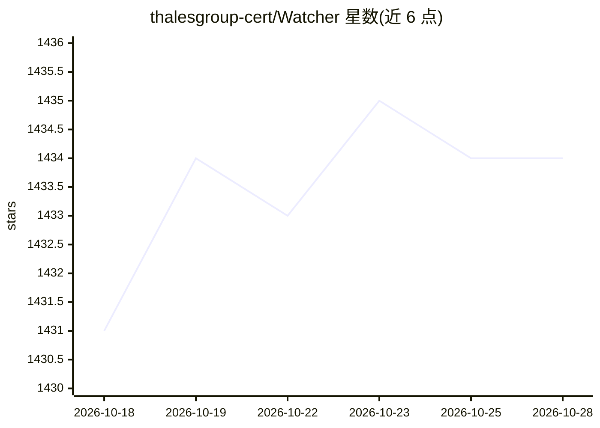

# thalesgroup-cert/Watcher

⭐ 1,434 · JavaScript · AGPL-3.0 · 推送 2026-10-28 · [GitHub](https://github.com/thalesgroup-cert/Watcher) · [官网](https://thalesgroup-cert.github.io/Watcher/) · 组织维护

**面向安全运营的 AI 威胁情报与监测平台**

Thales CERT 开发的 Django + React 威胁情报与狩猎平台：聚合 CERT-FR、CERT-EU、US-CERT 等 RSS 通告、CVE 与勒索软件数据，监控恶意域名（TLSH 模糊哈希、RDAP/WHOIS）、信息泄露与 DGA 仿冒域名，并通过 Hugging Face Transformers（flan-t5-base 摘要、bert-base-NER 实体抽取）生成每周威胁摘要与突发新闻告警。支持 TheHive/MISP 集成、SSO/OIDC 认证、Slack/Citadel 通知，可用 Docker 部署。

## 筛选速览

| 维度 | 判定 | 备注 |
|---|---|---|
| AI 角色 | `ai-enhanced` | 去掉 AI 部分产品仍成立 |
| 许可风险 | `viral` | AGPL-3.0 |
| 部署形态 | `self-host` | docker 或自建部署 |
| 模型依赖 | — | README 未给出锁定关系 |
| 硬件要求 | — | 无带数字的原话,不猜 |
| 安装摩擦 | `low` | 无编译、无系统依赖或容器化 |
| 成熟度 | — | 结构信号不足 |

## 能力要点

- AI 周报与突发威胁新闻：flan-t5-base 摘要 + bert-base-NER 自动 IOC 抽取
- 证书透明度实时监控（certstream）与 dnstwist DGA/仿冒域名检测
- Pastebin/GitHub/StackOverflow 等平台的信息泄露监测
- TheHive 同步、MISP IOC 导出与 OIDC/LDAP/SSO 认证

## 适用场景

- 持续监测针对本组织的恶意域名与信息泄露
- 聚合多国 CERT 通告并按关键词规则接收威胁告警
- 将 IOC 推送到 MISP/TheHive 协同事件响应流程

## 场景标签

`网络安全` · 领域:学习与行业

## 证据(README 行号)

> L31: Watcher is a Django & React JS platform designed to discover and monitor emerging cybersecurity threats with **AI-p
> L73: - **Hugging Face Transformers** - AI/ML framework powering threat intelligence summarization and entity extraction

## 星数曲线

2026-10-18 1,431 → 2026-10-28 1,434（+3）

---
*卡片 v1 · prompt 1.4 · 生成 2026-10-21 · 置信度 mid · 依据 README sha `68fa696521bf` · [字段定义](../../DATASET.md)*
