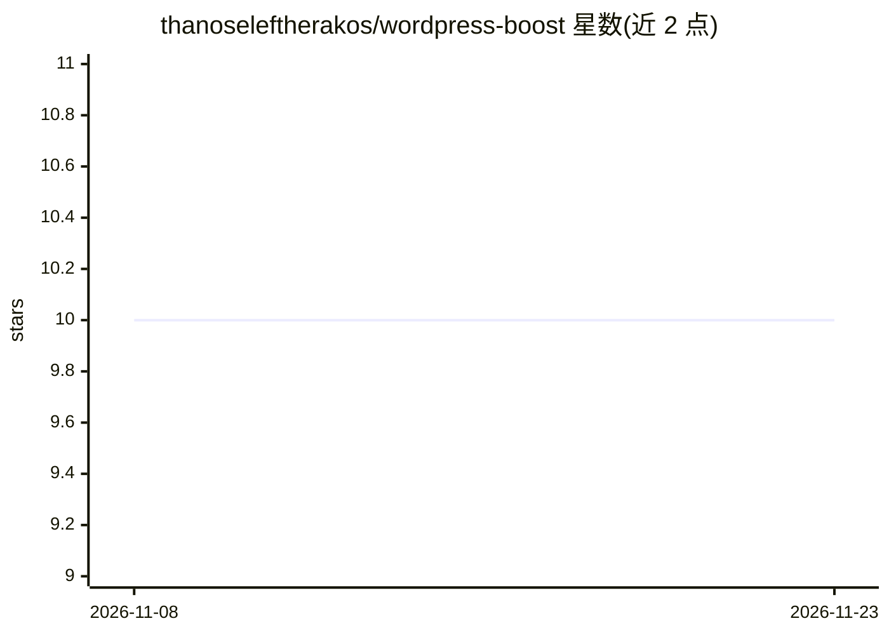

# thanoseleftherakos/wordpress-boost

⭐ 10 · PHP · 推送 2026-07-08 · [GitHub](https://github.com/thanoseleftherakos/wordpress-boost) · 个人维护

**把 WordPress 内部信息通过 MCP 暴露给 AI 编程助手的工具**

以 MCP server 形式向 AI Agent 提供 WordPress 代码库上下文：30+ 个工具覆盖 hooks 注册回调、数据库 schema、post types/taxonomies/REST 端点、站点安全审计（代码漏洞扫描与站点配置检查，A-F 评分）、ACF/WooCommerce 配置读取，以及基于 Faker 的测试数据生成。经 Composer 安装到 WordPress 项目，--init 生成 .mcp.json 并向 .ai/ 目录写入 guidelines 与 skills；CLI 模式加载 WordPress 运行。要求 PHP 7.4+、WordPress 5.0+。

## 筛选速览

| 维度 | 判定 | 备注 |
|---|---|---|
| AI 角色 | `ai-ecosystem` | LLM/agent 周边工具 |
| 许可风险 | `none` | — |
| 部署形态 | `None` |  |
| 模型依赖 | — | README 未给出锁定关系 |
| 硬件要求 | — | 无带数字的原话,不猜 |
| 安装摩擦 | `low` | 无编译、无系统依赖或容器化 |
| 成熟度 | — | 结构信号不足 |

## 能力要点

- 30+ MCP 工具：hooks、schema、REST 端点、cron、rewrite 规则等内省
- 安全审计：SQL 注入/XSS 扫描与站点配置检查，A-F 评分
- 安装 guidelines 与 skills 到项目 .ai/ 目录
- wp_shell 限制于 WP_DEBUG 开启且禁用 exec/eval 等操作

## 适用场景

- 让 AI 编程助手读取当前 WordPress 项目的 hooks 与数据库结构后生成代码
- 对站点做配置与代码层面的安全审计
- 为开发环境批量生成测试文章、用户与 WooCommerce 商品数据

## 场景标签

`代码审查` `代码生成` · 领域:编码与开发

## 证据(README 行号)

> L9: WordPress Boost accelerates AI-assisted development by providing deep context about your WordPress codebase, compreh
> L22: 30+ specialized tools to scan hooks, post types, taxonomies, REST endpoints, database schema, and more - giving AI 
> L262: 2. MCP Protocol (JSON-RPC over stdio)

## 星数曲线

2026-11-08 10 → 2026-11-23 10（+0）

---
*卡片 v1 · prompt 1.4 · 生成 2026-11-19 · 置信度 high · 依据 README sha `a019935c81b2` · [字段定义](../../DATASET.md)*
